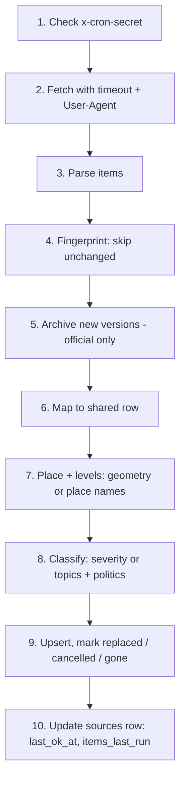

# Local Pulse — Build Spec

Version 1.0 · September 26, 2026 · Team: Yatharth Tomar (product, connectors, AI) + coding partner (app, map, database)
Contest: 2026 Congressional App Challenge · Code freeze **Thu Oct 22, 9 p.m.** · Submit **Sun Oct 25** · Hard deadline **Mon Oct 26, 9:00 a.m. Arizona time**

This file is the single source of truth for building Local Pulse. It is written for two readers at once: the two students on the team, and Claude Code working in this repository. Read [CLAUDE.md](CLAUDE.md) first; it sets the rules for how AI may help (the contest requires it).

---

## 0. How to use this file

1. Scaffold the Next.js app and copy the whole build kit to the root of the `local-pulse` repo, following `README-FIRST.md` (§5 shows the final layout).
2. Open Claude Code in the repo. First message: *"Read CLAUDE.md and BUILD.md, look at every image in docs/concepts, then propose a plan for milestone M0 only. Don't write code yet."*
3. Work one milestone at a time (§27). Each milestone lists what the humans hand-write, what Claude Code may do, and the checks that prove it's done.
4. When this file and the images disagree, this file wins. When this file and a live API disagree, the live API wins: fix this file in the same pull request.
5. Anything marked **[verified]** was tested against the live source between Sept 24 and Sept 26, 2026. Anything marked **[check]** could not be verified and must be confirmed in week one.

Words used in this file:

| Word | Meaning |
|---|---|
| Level | One of five views: World, Region, State, County, Local |
| Alert / notice | An official item from a government or intergovernmental source (the Alerts tab) |
| Story / headline | A news item from a news outlet (the News tab) |
| Place | The user's saved point (home). The center of the Local circle |
| Ring | The 20-mile circle around the place |
| Panel / sheet | The pull-up panel at the bottom of the map |

---

## 1. Product in one page

**One sentence (say it word for word in the video):** "Local Pulse is a spinning globe where you zoom from world news down to the news and official alerts within 20 miles of your home."

**Who it's for:** Phoenix-metro residents. Test users: a parent checking school, road and water notices before the day; a new student driver; an older resident who needs heat and air-quality warnings; a family that just moved here.

**What it does:**

- Opens on a slowly spinning, NASA-imagery globe. A **World news** pill opens world headlines and major world alerts.
- As you zoom, the panel follows the level: **World → Region (the country, e.g. U.S.) → State (Arizona) → County (Maricopa) → Local (20 miles around your place)**.
- Two tabs at every level: **News** (headline, outlet, time, link only) and **Alerts** (official notices with severity, plain-language summary, link to the original).
- Local shows only what is within 20 miles of the saved place, so the list stays short (about 10 stories per 48 hours in testing).
- Politics, elections and opinion pieces are filtered out of the news, and the list says how many were hidden and why.
- Full depth (County and Local) is Arizona-only for v1. Other states stop at State level with an honest note.

**Must-have features (all 13 must work on a real iPhone and Android phone by Oct 16):**

| # | Feature | # | Feature |
|---|---|---|---|
| 1 | Spinning globe that zooms to street level, with Census outlines | 8 | Auto-expire old alerts |
| 2 | Where am I: location or typed address → saved place | 9 | Sources and AI page with live "last checked" dots |
| 3 | Official connectors (NWS, AZ511, Maricopa County, Phoenix meetings) | 10 | News by level (five levels, breadcrumb, World news pill) |
| 4 | Alert cards + detail | 11 | News connectors + politics filter + duplicate merge |
| 5 | Plain-language AI summaries with fact check | 12 | Headline place matching (geotag) |
| 6 | Category and topic chips | 13 | Local radius: ring, distances, 10/20/30 setting |
| 7 | Severity colors + legend | | |

**Stretch (only after all 13 work):** several saved places, a "Today" summary, Spanish, push alerts for red alerts, a text-only list view.

**What it never does:**

- Show article text, photos or AI summaries of news (copyright, accuracy).
- Let AI choose severity, choose what is shown, or add facts.
- Store who looked at what, or store the user's address.
- Use government seals or agency logos.

---

## 2. Contest rules that shape the code

| Rule | What it means in the codebase |
|---|---|
| All coding by the team; AI allowed only if fully disclosed and not the whole technical build | `CLAUDE.md` marks **human-first modules** that the students write themselves. Every AI-assisted change gets a line in `docs/AI_USE_LOG.md`. This spec, the reference migrations and the prototype were AI-written and are already logged. |
| Open-source libraries and outside tools must be documented | `README.md` lists every dependency, data source and license (§29). |
| Judges may request source code; missing code = disqualification | Public GitHub repo, clean history, meaningful commits from both students, MIT license. |
| Code must be created after Oct 30, 2025 | Fresh repo started Sept 2026. Don't paste older personal code. |
| No IP violations, nothing defamatory | Headline + link only for news. No seals/logos. Attribution lines (§29). |
| App must work when judges open it (Nov–Jan) | Keep Vercel and Supabase live through **Jan 15, 2027**. Cron jobs keep the free Supabase project from pausing. |

---

## 3. Concept screenshots

All images are in `docs/concepts/`. They were rendered from `reference/prototype.html` at iPhone size (393 × 852, with the installed-app safe areas: 59 px top, 34 px bottom). **Every headline in them is a made-up sample** tagged SAMPLE, with generic outlet names. The World and Region alerts are real items from the public feeds on Sept 26, 2026. The saved place is downtown Phoenix (Phoenix City Hall), not a real user.

| File | What it shows | Match exactly | Don't copy |
|---|---|---|---|
| `01-first-open.jpg` | First open: spinning globe, brand mark, welcome card | Layout, copy, card style, globe centered above the card | — |
| `02-world-globe.jpg` | World level, panel closed, **World news** pill | Pill style and position; alert pins on the globe; top bar over space | — |
| `03-world-news-open.jpg` | World news panel open | Panel header, News/Alerts tabs, chips, news card anatomy, close button | The orange "Design mock" label |
| `04-region-us.jpg` | Region level (U.S.) | Breadcrumb `World › U.S.`, level tag REGION, dark theme above the panel | Sample headlines |
| `05-state-arizona.jpg` | State level (Arizona) | Satellite still visible at this zoom; Arizona outline in cyan; "2 outlets" merged card | — |
| `06-county-maricopa.jpg` | County level | Light map, dashed county outline, place line on news cards ("📍 Phoenix area") | HTML pins (use symbol layers, §17) |
| `07-local-news.jpg` | Local level, News tab | Dashed 20-mile ring, "20 mi" label, home dot, dim outside ring, distance on cards ("Tempe · 7.8 mi") | — |
| `08-local-alerts.jpg` | Local level, Alerts tab | Alert card anatomy: color bar, badge (shape + word), category, headline, agency, time, distance | — |
| `09-phones-installed-flow.jpg` | Four screens inside an iPhone frame (installed app) | Safe areas; status-bar scrim over light maps | The phone frame itself |
| `10-phones-three-devices.jpg` | Local screen on installed iPhone, iPhone browser, Android Chrome | Panel height adapts to short screens (42% vs 48%) | Browser chrome drawings |
| `11-levels-walkthrough.gif` | Level-by-level walkthrough | Sequence and transitions | — |
| `12-globe-spin.gif` | Globe spin (sped up) | West-to-east direction; Arizona outline drifting left to right | Speed (real speed is 3°/s) |
| `13-alert-polygon-and-cards-v1.jpg` | Earlier v1 layout: red warning polygon + alert cards | Polygon styling (16% fill, 2.2 px outline), card severity styles | The v1 breadcrumb and header |
| `14-imagery-handoff-z6.jpg` | Arizona at zoom 6.2 mid-handoff | Satellite fading into the street map, labels arriving | — |

`reference/prototype.html` is a single-file working prototype (MapLibre from a CDN). Open it in Chrome to feel the interactions. Useful URL endings: `#globe`, `#world`, `#worldnews`, `#region`, `#state`, `#county`, `#local`, `#local-alerts`, `#away` (zoomed in on Tucson, far from the saved place), plus `?nospin` and `?safe=59,34` (fake installed-iPhone safe areas). It is **AI-written reference code**: rebuild it properly in the app; don't paste it.

---

## 4. Tech stack

Pin exact versions in `package.json` at install time and record them in the README. Use the latest stable of each package **except MapLibre**, which stays on 5.24.0 (below).

| Layer | Choice | Notes |
|---|---|---|
| Web app | **Next.js 16** (App Router, 16.3.6 on Sept 26) + **TypeScript** + **React 19** | Scaffolded by hand before Claude Code starts (see `README-FIRST.md`). Next 16 changed APIs: read the generated `AGENTS.md` and `node_modules/next/dist/docs/` before writing Next code |
| Styling | **Tailwind CSS v4** + CSS variables for design tokens (§20) | Tokens live in `app/globals.css`; Tailwind reads them through `@theme inline` |
| Map | **MapLibre GL JS 5.24.0** (`maplibre-gl@5.24.0`, the last v5) | Globe projection, sky/atmosphere. Client-only component. **Don't use v6** during the contest: v6 (July 2026) is ESM-only and WebGL2-only with breaking API changes, and every measurement in this spec was made on v5 |
| Base map | **OpenFreeMap** Positron style `https://tiles.openfreemap.org/styles/positron` | No key, no limits **[verified]** |
| Globe imagery | **NASA GIBS** `BlueMarble_ShadedRelief_Bathymetry` WMTS, `GoogleMapsCompatible_Level8` | Public domain, no key **[verified]** |
| Geometry helpers | `@turf/circle`, `@turf/distance`, `@turf/bbox`, `@turf/boolean-point-in-polygon` | Import per-function packages to keep the bundle small |
| Icons | `lucide-react` (UI) + Lucide SVGs rasterized for map symbols | ISC license |
| Database | **Supabase** Postgres + **PostGIS** | Free plan. Migrations in `supabase/migrations/` |
| Jobs | **Supabase Edge Functions** (Deno, TypeScript) + **Supabase Cron** (`pg_cron` + `pg_net`) | Vercel Hobby cron runs only once a day, so don't use it |
| Backup scheduler | GitHub Actions `schedule:` on the public repo | Only if Supabase Cron misbehaves |
| XML parsing (Deno) | `npm:fast-xml-parser` | RSS/Atom |
| DB client | `@supabase/supabase-js` v2 (app: anon key; functions: service role) | |
| AI summaries | Anthropic Messages API, model `claude-haiku-4-5` | Temperature 0, one call per notice, saved forever |
| Pure logic shared by functions and tests | `supabase/functions/_shared/logic/*.ts` | No Deno APIs inside, relative imports with `.ts` extensions, so both Deno and Vitest can load them |
| Unit tests | **Vitest** | Pure functions: levels, geotag, politics, dedupe, severity, time, fact check |
| E2E tests | **Playwright** at 393×852, 393×659 and 412×804 | Level switching, panel, ring |
| Hosting | **Vercel** Hobby | Auto-deploy from `main`; previews on PRs |
| Hand-made data | Census Gazetteer, TIGERweb, Natural Earth | Loaded once by scripts (§8) |

**Languages to name in the video:** TypeScript, JavaScript, SQL (PostgreSQL + PostGIS), HTML, CSS.

---

## 5. Repository layout

```text
local-pulse/
  CLAUDE.md                     rules for Claude Code (from the kit)
  BUILD.md                      this spec
  README.md                     what it is, how to run, sources, licenses, AI disclosure
  LICENSE                       MIT
  .env.example                  blank template (§6)
  app/
    layout.tsx                  fonts, metadata, viewport, manifest link
    page.tsx                    the map screen (client shell)
    sources/page.tsx            Sources and AI page
    notice/[id]/page.tsx        notice detail (also opens as a sheet from the map)
    manifest.ts                 web app manifest
    icon.png, apple-icon.png    app icons (Next.js file conventions; apple icon 180 px)
    api/
      where/route.ts            GET  point -> country/state/county/place
      feed/route.ts             GET  world/region/state/county feed (cached)
      feed/local/route.ts       POST local feed (not cached, not logged)
      geocode/route.ts          POST proxy to the Census Geocoder (no CORS there; POST keeps addresses out of logs)
      region-status/route.ts    GET  per-state alert counts for Region shading (live from NWS, cached 5 min)
      notice/[id]/route.ts      GET  one notice
      sources/route.ts          GET  source status dots
  components/
    map/GlobeMap.tsx            MapLibre setup, projection, imagery, layers
    map/layers.ts               source + layer definitions per level
    map/symbols.ts              rasterize Lucide icons for symbol layers
    map/spin.ts                 spin controller (HUMAN-FIRST: partner)
    StarField.tsx               canvas behind the map, drawn once
    WelcomeCard.tsx
    TopBar.tsx                  search + breadcrumb
    Breadcrumb.tsx
    Sheet.tsx                   pull-up panel with three stops
    SheetHeader.tsx, Tabs.tsx, Chips.tsx
    NewsCard.tsx, AlertCard.tsx, HiddenNote.tsx, EmptyState.tsx, SkeletonCards.tsx
    WorldNewsPill.tsx, SetPlaceButton.tsx, Legend.tsx, OfflineBanner.tsx
    NoticeDetail.tsx, WhySheet.tsx, OutletsSheet.tsx
  lib/
    levels.ts                   level math (HUMAN-FIRST: partner)
    tokens.ts                   the §20 colors as JS constants for MapLibre paint (it can't read CSS variables)
    geo.ts                      bbox, ring, rounding helpers
    time.ts                     America/Phoenix formatting
    severity.ts                 display helpers for severity (words, shapes, colors)
    strings.ts                  every piece of on-screen text
    api.ts                      typed fetchers for the app's own API
    store.ts                    small app state (level, place, tab, filters)
    storage.ts                  safe localStorage wrapper
  supabase/
    config.toml
    migrations/0001_init.sql    schema, RLS, feed(), upsert_area() (reference, from the kit; apply with `supabase db push`)
    migrations/0002_upsert_notice.sql   upsert_notice() RPC (HUMAN-FIRST: partner, §9.1)
    sql/schedule.sql            cron jobs (reference, from the kit; NOT a migration, run once by hand)
    functions/
      _shared/                  db client, fetch helpers, pipeline steps, auth, xml (Deno)
      _shared/logic/            pure TypeScript, no Deno APIs (tested by Vitest):
        geotag.ts               HUMAN-FIRST: Yat
        politics.ts             HUMAN-FIRST: Yat (+ politics-names.ts, the names list)
        factcheck.ts            HUMAN-FIRST: Yat (extractFacts, checkSummary)
        topics.ts, dedupe.ts (+ common-words.ts), severity.ts, nwsText.ts, time.ts
      nws/                      HUMAN-FIRST: partner
      nws-region/
      az511/                    HUMAN-FIRST: partner
      maricopa-rss/             HUMAN-FIRST: Yat
      phx-legistar/             HUMAN-FIRST: Yat
      usgs/ gdacs/ eonet/ who/ fema/
      az-news/                  12News + azfamily + Cronkite
      gdelt/
      summarize/                HUMAN-FIRST: Yat (prompt handling)
  scripts/
    load-boundaries.ts          TIGERweb + Natural Earth -> areas table + public/geo/*.json
    load-gazetteer.ts           Census Gazetteer -> place_names + public/geo/az-place-names.json (HUMAN-FIRST: Yat)
    capture-still.ts            Playwright: screenshot of the globe for the instant first paint
  public/
    geo/                        simplified GeoJSON served to the map + az-place-names.json for autocomplete (§8)
    globe-still.jpg             first-paint image
    og.jpg                      link-preview image (1200×630)
    icons/                      manifest icons (192, 512, 512 maskable)
  tests/
    unit/*.test.ts              Vitest
    e2e/*.spec.ts               Playwright
    fixtures/                   real feed samples from Sept 26, 2026 (from the kit)
    cases/                      case tables: levels, geotag, politics, severity, factcheck, dedupe (+ README with scores)
  docs/
    concepts/                   screenshots (from the kit)
    AI_USE_LOG.md
  reference/prototype.html      AI-written visual reference (don't import)
  data/                         source files for the loaders (from the kit)
```

`HUMAN-FIRST` modules are listed in `CLAUDE.md`, which is the single source of truth for that list. The split follows the team roles: Yat owns the gazetteer loader, the county and meetings connectors, the news filters and the AI summary; the partner owns the level logic, the spin, the notice upsert RPC, and the weather and road connectors.

**Config the scaffold needs:**
- `tsconfig.json`: add `"supabase/functions"` to `exclude` (Deno code has `Deno.*` globals and `npm:` imports that `tsc` for Next can't resolve). Vitest still imports `_shared/logic/*.ts` directly.
- ESLint: ignore `supabase/functions/**`.
- `package.json` scripts: `"typecheck": "tsc --noEmit"`, `"test": "vitest run"`, `"e2e": "playwright test"`.
- `.gitignore`: the generated file ignores `.env*`, which also hides `.env.example`. Add a line `!.env.example`.

---

## 6. Environment and secrets

`.env.example` (commit this, with blank values):

```bash
# Browser-safe (Next.js exposes NEXT_PUBLIC_*)
NEXT_PUBLIC_SUPABASE_URL=
NEXT_PUBLIC_SUPABASE_ANON_KEY=
NEXT_PUBLIC_SITE_URL=            # e.g. https://local-pulse.vercel.app

# Server-only (Vercel env vars; never NEXT_PUBLIC)
SUPABASE_SERVICE_ROLE_KEY=       # only if an API route truly needs it; prefer the anon key + RPC
```

Supabase Edge Function secrets (`supabase secrets set NAME=value`):

| Secret | Used by |
|---|---|
| `SUPABASE_URL`, `SUPABASE_SERVICE_ROLE_KEY` | Provided automatically in Edge Functions |
| `CRON_SECRET` | Every scheduled function checks the `x-cron-secret` header against it |
| `AZ511_KEY` | az511 |
| `ANTHROPIC_API_KEY` | summarize |
| `NWS_USER_AGENT` | nws, nws-region, e.g. `LocalPulse/1.0 (contact: team email)` |

Local Edge Function secrets go in `supabase/functions/.env` (git-ignored) for `supabase functions serve`.

Supabase Vault (for cron, §14): `project_url` and `cron_secret`.

Rules: no key in client code, no key in the repo, no key in logs. The browser only ever sees the anon key, which RLS limits to read-only views.

---

## 7. Data model

The full reference migration is `supabase/migrations/0001_init.sql` (tested on Postgres 16 + PostGIS 3.4 on Sept 26, 2026 with sample rows at all five levels). Summary:

| Table | Purpose | Public can read? |
|---|---|---|
| `sources` | One row per feed; last run/ok/error times; powers the Sources page dots | Yes |
| `areas` | Every boundary: countries, states, AZ counties, AZ places, AZ school districts, cached NWS zones. `id` like `county:04013` | Yes |
| `place_names` | Census Gazetteer names + points for headline matching; `needs_cue`, `blocked` flags | Yes |
| `notices` | Official alerts. `levels text[]` says which level lists include it; `geom` for maps; `county_fips[]`; AI summary fields | Active + last 7 days |
| `news_items` | Headlines only (title, outlet, url, time) + levels, places, topics, `hidden_reason`, `cluster_id` | Only `hidden_reason is null` |
| `archive` | One row per new item version from official sources (raw JSON), for the demo replay | No |

Key design choices:

- **`levels`** on each row decides which lists it appears in. Connectors set it (§10). Examples: GDACS orange flood → `{world}`; NWS Dust Storm Warning in Maricopa → `{state,county,local}`; Maricopa County press release → `{county,local}`; 12News story naming Mesa → `{state,county,local}`.
- **Area matching lives in the database.** A trigger fills `area_ids`, `county_fips`, `state_fips` and `country_iso` from `geom` on insert/update. An area counts only when the shape **overlaps it by more than 1%** of the smaller of the two: a county-shaped notice shares borders with its neighbors, and plain `ST_Intersects` would tag it with all of them (caught in review, fixed and tested: a Maricopa-shaped notice now gets only `04013`). When a connector pre-fills `county_fips` (NWS SAME codes), the trigger keeps those instead of computing its own.
- **Geometry goes in through RPCs.** supabase-js can't send PostGIS geometry. Loaders and the NWS zone cache call `upsert_area(jsonb)` (reference, in `0001`), which repairs shapes with `ST_MakeValid`; `areas.geom` has a `st_isvalid` check. Notices go through `upsert_notice(jsonb)` (§9.1, written by the partner).
- **PostGIS lives in the `extensions` schema** (Supabase's recommendation), so its tables and functions aren't exposed through the public API. Functions set `search_path = public, extensions`.
- **`feed(lvl, lon, lat, radius_m, replay)`** returns everything the panel needs as one JSON object: `place`, `alerts[]`, `news[]` (merged clusters with an `outlets` count), `county_counts` (State level, for the county bubbles), `hidden` counts, `generated_at`. `radius_m` is clamped to 1–30 miles. `replay = true` returns alerts that ended in the last 7 days (the empty-state replay). It is `security definer` so it can count hidden items without exposing them.
- **Local distance** is measured to a place's **outline** when one is loaded, else its center point. In testing, Mesa's center point is 20.9 miles from Phoenix City Hall, so without outlines Mesa stories would fall just outside the ring.
- **Times** are `timestamptz` (UTC). Display is always America/Phoenix (§23).
- **Retention:** notices kept 30 days after they end (replay + evidence); news 7 days; archive until the contest ends. Every connector run sets `last_seen_at = now()` (and `status = 'active'`) on items it still sees, even when their version is unchanged; retention, replay and the RLS policy all key on `last_seen_at`.
- **Countries** use Natural Earth `ADM0_A3` as the code (`ISO_A3` is `-99` for France and Norway).

`feed()` output shape (the app's `lib/api.ts` types mirror it):

```ts
type Feed = {
  level: 'world' | 'region' | 'state' | 'county' | 'local';
  replay: boolean;
  place: { country_iso: string | null; country: string | null; country_short: string | null;   // 'United States' / 'U.S.'
           state_fips: string | null; state: string | null;
           county_fips: string | null; county: string | null; county_short: string | null;     // 'Maricopa County' / 'Maricopa'
           place: string | null };
  alerts: Array<{
    id: string; source: string; agency: string; category: string;
    severity: 'red' | 'orange' | 'yellow' | 'gray'; headline: string;
    summary: string | null;          // present only when the fact check passed
    original_text: string | null;    // present only when it failed (first 600 chars)
    url: string; issued_at: string; starts_at: string | null; until: string | null;
    miles: number | null;            // Local only: distance from the place to the alert's shape
    geom: GeoJSON.Geometry | null;   // simplified for drawing
  }>;
  news: Array<{
    id: string; outlet: string; title: string; url: string; published_at: string;
    topics: string[]; outlets: number;          // >1 when duplicates were merged
    place: string | null; miles: number | null; // miles only at Local
  }>;
  county_counts: Record<string, { count: number; max_sev: 'red' | 'orange' | 'yellow' | 'gray' }> | null;  // State level only
  hidden: { politics: number; opinion: number };
  generated_at: string;
};

Panel titles use the full names (`country`, `state`, `county`); the breadcrumb uses the short ones.
```

---

## 8. Boundaries and place names

Loaded once by scripts, re-runnable. `scripts/load-boundaries.ts` writes to the `areas` table (service role) **and** writes simplified GeoJSON files to `public/geo/` for drawing.

| Area kind | Source | Query / file | Count [verified] | Simplify for `public/geo/` |
|---|---|---|---|---|
| country | Natural Earth 1:110m admin 0 (public domain) | `https://raw.githubusercontent.com/nvkelso/natural-earth-vector/master/geojson/ne_110m_admin_0_countries.geojson`; code = `ADM0_A3`, name = `ADMIN`, short = `NAME` (use "U.S." for USA) | 177 | Already small; drawing optional |
| state | TIGERweb `State_County/MapServer/0` | `where=1=1` (all states), `outFields=NAME,GEOID,STUSAB`, `f=geojson`, `maxAllowableOffset=0.01` | 56 incl. territories | `states.json` ~150 KB |
| county (AZ) | TIGERweb `State_County/MapServer/1` | `where=STATE='04'` | 15 | `az-counties.json` |
| place (AZ, incorporated) | TIGERweb `Places_CouSub_ConCity_SubMCD/MapServer/4` | `where=STATE='04'` | 92 | `az-places.json` |
| place (AZ, CDPs) | TIGERweb `Places_CouSub_ConCity_SubMCD/MapServer/5` | `where=STATE='04'` | 375 | merge into `az-places.json` |
| unified school districts | TIGERweb `School/MapServer/0` | `where=STATE='04'` | 98 | `az-schools-unsd.json` (lazy) |
| secondary school districts | TIGERweb `School/MapServer/1` | `where=STATE='04'` | 15 | lazy |
| elementary school districts | TIGERweb `School/MapServer/2` | `where=STATE='04'` | 102 | lazy |
| NWS zones | `https://api.weather.gov/zones/forecast/{id}` | fetched on first use by the nws connector, cached as `zone:AZZ537` | — | not served |

TIGERweb base URL: `https://tigerweb.geo.census.gov/arcgis/rest/services/TIGERweb/`. TIGERweb (current vintage) has 92 incorporated places + 375 CDPs; the 2024 Gazetteer has 91 + 376 **[verified]**: one place changed status between the two. Both total 467. Always join places to polygons **by GEOID**, never by count or name. Page through with `resultOffset`/`resultRecordCount` if a layer returns `exceededTransferLimit`. Round coordinates to 5 decimals before saving (about 1 m). Convert every geometry to MultiPolygon (`ST_Multi`). Set `short_name` for breadcrumbs: countries → common name (`U.S.`), states → name, counties → name without "County" (`Maricopa`), places → name without " city"/" town"/" CDP".

`scripts/load-gazetteer.ts` loads `data/gazetteer/2024_Gaz_place_04.txt` (tab-separated; columns `USPS GEOID ANSICODE NAME LSAD FUNCSTAT ALAND AWATER ALAND_SQMI AWATER_SQMI INTPTLAT INTPTLONG`; 467 Arizona places: 46 cities, 45 towns, 376 CDPs **[verified]**; the file is Latin-1 and has trailing spaces on the last column). For each row: `name` = NAME without the final ` city`/` town`/` CDP`; `kind` from that suffix; `point` from INTPTLONG/INTPTLAT; `county_fips` by point-in-county; `area_id` = `place:<GEOID>` when that polygon exists; then set flags from §12 (`needs_cue`, `blocked`). It also writes `public/geo/az-place-names.json` (`[{ geoid, name, county }]`, about 20 KB) so the address box can suggest places **in the browser** without sending keystrokes anywhere.

The four files in `data/boundaries/` (Arizona, Maricopa County, Phoenix, Deer Valley Unified) are the small subset the prototype uses. They're handy for tests; the real app loads full sets with the script.

---

## 9. Ingestion pipeline

Every connector is a Supabase Edge Function that runs on a schedule (§14). Official items and news items share the same outer shape:



Shared code in `supabase/functions/_shared/`:

| File | Does |
|---|---|
| `auth.ts` | `requireCron(req)`: 401 unless header `x-cron-secret` equals `Deno.env.get('CRON_SECRET')` |
| `db.ts` | Service-role Supabase client (`npm:@supabase/supabase-js@2`) |
| `http.ts` | `fetchText(url, { timeoutMs = 15000, headers })` and `fetchJson` with AbortController; one retry after 2 s on 5xx/timeout; never retries 4xx |
| `xml.ts` | `parseRss(xml)` using `npm:fast-xml-parser` (keep CDATA, strip HTML with a small function, decode entities) |
| `pipeline.ts` | `versionKey()`, `archiveNew()`, `upsertNotices()`, `upsertNews()`, `markGone()`, `recordRun()` |
| `news/*.ts` | geotag, politics, topics, dedupe (§11, §12) |
| `time.ts` | Parse RFC 822 (RSS), ISO 8601 with offsets, Unix seconds (AZ511) → `Date` (UTC) |

Function names and source ids (`recordRun` takes the source id; the `sources` table is keyed by it):

| Function (folder, cron job) | Source id(s) it records |
|---|---|
| `nws` | `nws` |
| `nws-region` | `nws_region` |
| `az511` | `az511` |
| `maricopa-rss` | `maricopa_rss` |
| `phx-legistar` | `phx_legistar` |
| `usgs`, `gdacs`, `eonet`, `who`, `fema`, `gdelt` | same as the name |
| `az-news` | `12news`, `azfamily`, `cronkite` (one `recordRun` per outlet, so one broken feed shows its own red dot) |
| `summarize` | none (it isn't a source) |

Connector contract (every function follows it):

```ts
// supabase/functions/<function>/index.ts
import { requireCron } from '../_shared/auth.ts';
import { recordRun } from '../_shared/pipeline.ts';

Deno.serve(async (req) => {
  const denied = requireCron(req); if (denied) return denied;
  const started = Date.now();
  try {
    const n = await run();                           // fetch -> parse -> map -> upsert
    await recordRun('<source-id>', { ok: true, items: n });
    return Response.json({ ok: true, items: n, ms: Date.now() - started });
  } catch (err) {
    await recordRun('<source-id>', { ok: false, error: String(err).slice(0, 500) });
    return Response.json({ ok: false }, { status: 500 });  // one failing source never touches the others
  }
});
```

Rules for every connector:

1. **Keep the source link.** No URL, no row.
2. **Never change the facts.** `original_text` is the agency's text exactly (after joining hard-wrapped lines, §10.1).
3. **Idempotent.** Re-running adds nothing new. `version_key = source + ':' + source_item_id + ':' + last_updated` (or a hash of the item when there's no update time). Items seen again with the same version still get `last_seen_at = now()`.
4. **Archive before mapping** (official sources only): insert into `archive` with `on conflict (source, version_key) do nothing`.
5. **Items that disappear.** For feeds that list only what is active (`nws`, `nws_region`, `az511`, `gdacs`, `eonet`), any active row **from that same source id** not seen in this run gets `status = 'expired'`. `expire_old()` skips these five sources. Row ids always start with the source id (`nws:…`, `nws_region:…`), so two sources never collide.
6. **Be polite.** Send `User-Agent: LocalPulse/1.0 (contact email)` everywhere. Obey rate limits (AZ511: 10 calls/60 s; GDELT: 1 call/5 s).
7. **Log little.** `console.log` counts only, never item text or coordinates of users (there are none server-side anyway).

### 9.1 `upsert_notice(n jsonb)` (HUMAN-FIRST: partner)

Every official connector writes notices through this one Postgres function (a new migration, `0002_upsert_notice.sql`), because supabase-js can't send PostGIS geometry and because the update/cancel rules belong in one place. The partner writes it; the contract:

| Input field | Meaning |
|---|---|
| all `notices` columns except `geom`, `area_ids`, `sev_rank`, `first_seen_at`, `last_seen_at` | as in §7 |
| `geometry` | GeoJSON or null → `ST_MakeValid(ST_SetSRID(ST_GeomFromGeoJSON(...), 4326))` |
| `zone_ids` | optional list like `{AZZ501, AZZ502}`: when `geometry` is null, union the cached `areas` rows `zone:<id>` |
| `replaces` | optional list of older ids (NWS `references`): set those rows `status='replaced', replaced_by = id` |
| `cancel` | true for an NWS Cancel message: set the `replaces` rows to `cancelled` and don't insert |

Behavior: same `id` and same `version_key` → only `last_seen_at = now(), status = 'active'`, return `'unchanged'`. Same `id`, new `version_key` → update the row, return `'updated'`. New `id` → insert, return `'inserted'`. The area trigger runs on insert/update. Grant execute to the service role only.

Test cases (SQL, against `tests/sql` seeds): insert returns `inserted`; the same call again returns `unchanged` and moves `last_seen_at`; a changed `version_key` returns `updated`; a row whose `replaces` names `nws:1` leaves `nws:1` as `replaced`; `cancel: true` leaves it `cancelled` and inserts nothing; `zone_ids` with two cached zones gives a MultiPolygon covering both.

---

## 10. Connectors

Poll intervals match the `sources` seed rows and the cron table (§14).

### 10.1 National Weather Service — `nws` (HUMAN-FIRST: partner) · every 5 min

- **URL:** `https://api.weather.gov/alerts/active?area=AZ` · `Accept: application/geo+json` · `User-Agent` required **[verified]**. Fixture: `tests/fixtures/nws_active_AZ.json`, `nws_recent_AZ.json` (25 recent AZ alerts incl. updates).
- **Item id:** `properties.id` (a `urn:oid:...`). Row id: `nws:<id>`.
- **Version key:** `id + properties.sent`.
- **Updates and cancels:** `messageType` is `Alert`, `Update` or `Cancel`. `references[].identifier` lists older versions. Pass them to `upsert_notice` as `replaces` (Update) or with `cancel: true` (Cancel).
- **Geometry:** `geometry` is often null (all three active Flood Watches on Sept 26 had none) **[verified]**. Then fetch each `affectedZones` URL not yet cached (e.g. `https://api.weather.gov/zones/forecast/AZZ501`, returns a Polygon **[verified]**), save it with `upsert_area` as `zone:AZZ501`, and pass the zone ids to `upsert_notice` as `zone_ids`.
- **Counties:** `geocode.SAME` holds six-digit codes like `004013`; drop the leading `0` → county FIPS `04013` (Maricopa). Pre-fill `county_fips` with these.
- **Levels:** `{state,county,local}`.
- **Headline:** `event` (e.g. "Flood Watch"). Never show `parameters.NWSheadline` (ALL CAPS) **[verified]**; never show `headline` (it includes the issuing office and times in its own format).
- **Text:** `description` is hard-wrapped at ~70 characters and uses `* WHAT...`, `* WHERE...`, `* WHEN...`, `* IMPACTS...` blocks **[verified]**. Join lines inside paragraphs (`\n` not followed by `\n` or `*` → space). Keep the blocks: the detail screen shows WHAT/WHERE/WHEN/IMPACTS as labeled rows, verbatim. `instruction` goes to `instruction` verbatim.
- **Times:** `sent` → `issued_at`; `onset` (or `effective`) → `starts_at`; `ends` → `ends_at`; `expires` → `expires_at`. Show "until" from `ends`, else `expires`. Times arrive with the issuing office's offset (Tucson and Phoenix send `-07:00`; offices in other zones may send `-08:00`) **[verified]**; parse them as absolute instants.
- **Agency:** `senderName` (e.g. "NWS Tucson AZ") → display "National Weather Service Tucson".
- **Link for the card:** NWS has no stable, friendly page per alert (`properties.web` is just `http://www.weather.gov` **[verified]**). Link to the point forecast page at the alert's center, which lists active hazards at the top: `https://forecast.weather.gov/MapClick.php?lat=<lat>&lon=<lon>` (responds **[verified]**; **[check]** that hazards show). Keep `properties['@id']` as `source_item_id`.
- **Severity:** §11.1.
- **Gone:** any active `nws` row not in this run's feed → `expired`. (This is why `expire_old()` skips NWS.)

### 10.2 NWS nationwide (Region level) — `nws-region` · every 15 min

- `https://api.weather.gov/alerts/active?severity=Extreme,Severe&message_type=alert,update` → 57 items nationwide on Sept 26 (48 of them updates) **[verified]**. Updates must be included, or an extended warning drops out of the list; apply the same `replaces` logic as §10.1. Source id `nws_region`; row id `nws_region:<id>`; `levels={region,state}`; `country_iso='USA'`; `state_fips` from the first two letters of `geocode.UGC` (e.g. `AZC013` → AZ → 04; keep a 50-state lookup table). For Arizona rows use `levels={region}` only (the `nws` connector already covers Arizona at State level). Severity §11.1. No zone shapes (Region and other states show lists, not polygons).
- `https://api.weather.gov/alerts/active/count` → `{ total, land, marine, regions, areas: { AZ: 3, CA: 8, ... }, zones }` **[verified]**. `/api/region-status` fetches it live (with the `User-Agent`), keeps only the 50 states + DC (drops marine areas like `AM`, `AN`), and caches 5 minutes. No table. The Region map shades each state by its count (§17).

### 10.3 ADOT AZ511 — `az511` (HUMAN-FIRST: partner) · every 5 min

- **Key:** free. Make an AZ511 account, request a developer key from the account page. Store as `AZ511_KEY`.
- **Limit:** 10 calls per 60 seconds **[verified in the docs]**. This connector makes 2 calls per run.
- **Events:** `https://az511.com/api/v2/get/event?key=<key>&format=json` **[verified in the docs]**. Fields: `ID, SourceId, Organization, RoadwayName, DirectionOfTravel, Description, Reported, LastUpdated, StartDate, PlannedEndDate` (Unix seconds), `LanesAffected, Latitude, Longitude, LatitudeSecondary, LongitudeSecondary, EventType` (`roadwork` | `closures` | `accidentsAndIncidents`), `EventSubType, IsFullClosure, Severity, EncodedPolyline, Restrictions, DetourPolyline, DetourInstructions, Recurrence, RecurrenceSchedules, Details, LaneCount`.
- **Alerts:** `https://az511.com/api/v2/get/alerts?key=<key>&format=json`. Fields: `Id, Message, Notes, StartTime, EndTime, LastUpdated, Regions, HighImportance, SendNotification`. Alerts have no coordinates: always `levels={state}` and `state_fips='04'`; `HighImportance` → orange, else yellow.
- **Geometry:** decode `EncodedPolyline` (Google polyline, precision 5) to a LineString when present; else a Point from `Latitude/Longitude`.
- **Headline:** `"<RoadwayName> <DirectionOfTravel>: <EventSubType or EventType in words>"`, e.g. "I-17 Northbound: Lane closure". Text: `Description` verbatim.
- **Levels (events):** full closures → `{state,county,local}`; every other event → `{county,local}`.
- **Severity values:** the docs don't list `Severity` values. In week one, log the distinct values for two days and finish the mapping in §11.1.
- **Gone:** events missing from the feed → `expired`.

### 10.4 Maricopa County News Flash — `maricopa-rss` (HUMAN-FIRST: Yat) · every 30 min

- **URL:** `https://www.maricopa.gov/RSSFeed.aspx?ModID=1&CID=All-newsflash.xml` **[verified]**. Fixture: `tests/fixtures/maricopa_newsflash.xml` (16 items).
- **Item id:** the `aid` number in the link (`CivicAlerts.aspx?aid=3821`). Some links go to `content.govdelivery.com` bulletins instead; use the bulletin id there.
- **Text:** `description` is sometimes a single space (e.g. "Luis's Story") **[verified]**. Then `original_text` = title, and skip the AI summary (nothing to summarize).
- **Geometry:** Maricopa County polygon (`areas.id='county:04013'`). **Levels:** `{county,local}`. **Category:** `county`. **Severity:** gray, unless the title matches heat or health emergency words (§11.1).
- The politics filter does **not** apply to official sources.

### 10.5 City of Phoenix meetings (Legistar) — `phx-legistar` (HUMAN-FIRST: Yat) · every 6 hours

- **URL:** `https://webapi.legistar.com/v1/phoenix/events?$filter=EventDate ge datetime'<date 7 days ago, YYYY-MM-DD>'&$orderby=EventDate&$top=50` (no key) **[verified: syntax works]**. Fixture: `tests/fixtures/legistar_phoenix_events.json`.
- **Real data quirks [verified]:**
  - Upcoming meetings may not be posted yet. On Sept 26 the newest event in Legistar was Sept 24, so a filter from "today" returned nothing. Fetch from 7 days ago: show upcoming meetings as "Upcoming", and when there are none, show the most recent one as "Last meeting · Wed, Sep 23" so the Meetings chip is never blank.
  - The weekly **"General Information Packet"** is an event with `EventTime: null`. It's not a meeting: skip any event with no `EventTime` or with that body name.
  - `EventLocation` is often `phoenix.gov` (streamed) and sometimes `City Council Chambers`. Show it as written.
- **Card:** headline `EventBodyName`; text `"<weekday, Mon D>, <EventTime> · <EventLocation>"`; link `EventInSiteURL`; `starts_at` from `EventDate` (date) + `EventTime` (Arizona time); `ends_at` = start + 7 days (so the last meeting stays listed for a week; the card label says Upcoming or Last meeting by comparing `starts_at` with now).
- **Geometry:** City of Phoenix polygon (`place:0455000`). **Levels:** `{local}`. **Category:** `meetings`. **Severity:** gray.
- Show every meeting, never a selection, and no commentary (keeps it non-political).

### 10.6 USGS earthquakes — `usgs` · every 15 min

- **URL:** `https://earthquake.usgs.gov/earthquakes/feed/v1.0/summary/4.5_day.geojson` **[verified: 31 quakes]**. Fixture: `usgs_4.5_day.geojson`. Properties include `mag, place, time` (ms), `updated, url, title, alert` (PAGER: green/yellow/orange/red or null), `tsunami`.
- **World:** keep `mag >= 5.5` or `alert in (orange, red)`. **Region (U.S.):** quakes whose point falls inside `country:USA` and `mag >= 4.5`.
- Headline = `title` (e.g. "M 5.6 - 74 km ESE of Kokopo, Papua New Guinea"). Severity: gray (red if PAGER red, orange if PAGER orange). Category `quake`. `ends_at = time + 24 h`. U.S. quakes also get `country_iso='USA'` from the trigger, so they show at Region.

### 10.7 GDACS — `gdacs` · every 30 min

- **URL:** `https://www.gdacs.org/xml/rss.xml` **[verified: 300 items]**. Fixture: `gdacs_sample.xml` (25 items).
- Fields: `gdacs:alertlevel` (Green/Orange/Red), `gdacs:eventtype` (EQ, TC, FL, VO, DR, WF), `gdacs:eventid`, `gdacs:episodeid`, `gdacs:iscurrent`, `geo:lat`, `geo:long`, `title`, `link`, `pubDate`.
- Keep only **Orange** and **Red**, `iscurrent = true`. Row id `gdacs:<eventtype>-<eventid>`; version key adds `episodeid`.
- Point geometry; `levels={world}` plus `region` when the point is inside the country being viewed (the `country_iso` from the trigger handles this).
- Severity = alert level (orange/red). Badge word = GDACS's own ("Orange alert", "Red alert"). Credit "GDACS" on the card.

### 10.8 NASA EONET — `eonet` · hourly

- **URL:** `https://eonet.gsfc.nasa.gov/api/v3/events?status=open&days=7` **[verified]**. The response is JSON even though the server labels it `application/rss+xml` **[verified]**: parse the text as JSON.
- Keep categories `severeStorms`, `wildfires`, `volcanoes`. Geometry = the **last** entry in `geometry[]` (Point). Headline = `title`. Link = the first `sources[].url`, else the event `link`. Events that drop off the open list → expired (rule 5).
- Severity gray; badge = the category title ("Severe storm", "Wildfire", "Volcano"). `levels={world}` (+ `region` via country).

### 10.9 WHO Disease Outbreak News — `who` · every 6 hours

- **URL:** `https://www.who.int/api/news/diseaseoutbreaknews?$top=10&$orderby=PublicationDate desc` **[verified]**. Fixture `who_don.json` (fields trimmed).
- Headline = `OverrideTitle` when `UseOverrideTitle` is true, else `Title`. Link = `https://www.who.int/emergencies/disease-outbreak-news/item/<UrlName>` (opens **[verified]**). No geometry. `levels={world}`, severity gray, category `health`, `ends_at = PublicationDate + 14 days`.

### 10.10 OpenFEMA declarations — `fema` · every 6 hours

- **URL:** `https://www.fema.gov/api/open/v2/DisasterDeclarationsSummaries?$filter=declarationDate ge '<ISO date 30 days ago>'&$orderby=declarationDate desc&$top=200` **[verified]**. Fixture `fema_declarations.json`.
- One declaration has one row per designated county. Group by `femaDeclarationString`. Headline: `"<declarationTitle title-cased>: <type> declaration for <state>"`, where type is `DR` → disaster, `EM` → emergency, `FM` → fire management. The Sept 26 fixture (`EM-3654-HI`) gives "Tropical Storm Nolo: emergency declaration for Hawaii". `county_fips` = `fipsStateCode + fipsCountyCode` for each row (skip `000`).
- No geometry, so set `country_iso='USA'` and `state_fips=fipsStateCode` yourself. `levels={region,state}` (+ `county` when an Arizona county is designated). Severity gray. `ends_at = declarationDate + 30 days`. Link: `https://www.fema.gov/disaster/<disasterNumber>` **[check]** (the site blocks scripted checks).

### 10.11 Arizona news — `az-news` (12News, azfamily, Cronkite News) · every 30 min

| Outlet | Feed URL | Items [verified] | Notes |
|---|---|---|---|
| 12News | `https://www.12news.com/feeds/syndication/rss/news/local` | 40 | Sections are in the link path (`/article/news/crime/`, `/article/news/politics/elections/`, `/article/syndication/associatedpress/`) and in `<category>` |
| azfamily | `https://www.azfamily.com/arc/outboundfeeds/rss/?outputType=xml` | 20 | Includes **national Gray News stories** (a Cleveland house fire on Sept 26) and a "Seen On TV" promo item **[verified]** |
| Cronkite News | `https://cronkitenews.azpbs.org/feed/` | 15 | WordPress feed; `description` is HTML with an image; many sports stories; category "Politics & Policy" |

For each item:

1. Read `title`, `link`, `pubDate`, `category[]`, and (in memory only) `description` stripped of HTML, first 400 characters. **Never store the description or `content:encoded`.**
2. Drop promos: titles like "Seen On TV", "Watch live", "Newscast".
3. **Syndicated check:** hidden `syndicated` when the link path contains `/syndication/` **and** no Arizona place or county is found; or when `content:encoded` starts with a dateline like `CLEVELAND (WOIO/Gray News)` whose city isn't in Arizona.
4. **Place names:** §12 → places and counties. Then `county_fips` = the counties named in the text **plus** the `county_fips` of every matched place (from `place_names`), so a Mesa story lands in Maricopa County.
5. **Arizona signal:** if no place or county was found, the story still counts as Arizona news when the title or description contains `Arizona`, `Ariz.`, `the Valley`, `East Valley`, `West Valley`, `ADOT`, `DPS`, `ASU`, `NAU`, `University of Arizona`, `Sky Harbor`, `Maricopa County`, or `Pima County`. Otherwise hidden `not_local`.
6. **Levels:** always `state` (with `state_fips='04'`); plus `county` and `local` when a place or county was found.
7. **Politics/opinion:** §11.3 → `hidden_reason`.
8. **Topics:** §11.4.
9. **Duplicates:** §11.5 → `cluster_id`.
10. Row id = SHA-1 of the canonical URL (lowercase host, no query string, no trailing slash). `outlet` = the outlet name above.

Cronkite sports stories go to the `community` topic.

Before launch, email each outlet: "We show your headline and a link to your site, nothing else. Tell us if you'd like us to stop." Keep the replies.

### 10.12 GDELT — `gdelt` · every 30 min

- **API:** `https://api.gdeltproject.org/api/v2/doc/doc?query=<q>&mode=artlist&format=json&maxrecords=50&timespan=24h&sort=datedesc`.
- **Rate limit:** one request per 5 seconds, per IP. Our test machine got refused (shared IP) on Sept 26; it worked on Sept 24 **[verified]**. The function sleeps 6 s between calls and makes at most 5 calls per run.
- **Queries per run:**
  1. World: `(theme:NATURAL_DISASTER OR theme:CRISISLEX_O01_WEATHER OR theme:HEALTH_PANDEMIC OR theme:SCIENCE) -theme:ELECTION -theme:TAX_POLITICAL_PARTY -theme:LEADER sourcelang:english` (themes confirmed in GDELT's theme list **[verified]**; test the minus syntax in week one; if refused, drop the minus terms and rely on §11.3).
  2. Region U.S.: the same with `sourcecountry:US` **[check the country token; try `sourcecountry:unitedstates` if `US` fails]**.
  3–5. Three other states per run, in a fixed alphabetical rotation of the 49 states other than Arizona, picked from the clock so nothing needs storing: `slot = floor(epochMinutes / 30)`, states `(slot × 3 + i) mod 49` for i = 0, 1, 2. Every state refreshes about every 8 hours. No per-user counters: the app doesn't track what people look at.
- **Response:** `{ "articles": [ { "url", "url_mobile", "title", "seendate": "20260926T141500Z", "socialimage", "domain", "language", "sourcecountry" } ] }`. Ignore `socialimage` (no photos).
- **Rows:** outlet = `domain`; levels `{world}` or `{region}` (+ `country_iso='USA'`) or `{state}` (+ `state_fips`, and news window 48 h); run §11.3 politics filter and §11.5 duplicates. Other countries get no headlines in v1 (Region there shows world alerts located in that country and the note "News for other countries is coming in 2.0").
- **Credit:** "Headlines via The GDELT Project" under the World and Region lists, linking to gdeltproject.org.

### 10.13 Stretch sources

| Source | How | Notes |
|---|---|---|
| AirNow | `https://files.airnowtech.org/airnow/today/reportingarea.dat` (pipe-delimited) | Phoenix reporting area AQI forecast. Don't use AirNow's ZIP or lat/long API: AirNow lists those for retirement in fall 2026 |
| Phoenix water notices | Scrape `https://www.phoenix.gov/newsroom/water-services-news.html` | No feed. Only if time allows |
| School district | Ask the district for an RSS/calendar feed | If none, show "coming soon"; never fake it |
| FEMA IPAWS | Skip | Requires a signed agreement |

---

## 11. Classification rules

### 11.1 Severity (fixed rules, never AI)

The word in the event name wins over the `severity` field. Real data shows why: NWS labels **Flood Watch** as severity `Severe` **[verified]**; by severity alone it would be red "Act now", but a watch means "be ready".

**NWS** (evaluate top to bottom, first match wins):

| Event name contains | Color | Card word |
|---|---|---|
| `Emergency` (e.g. Flash Flood Emergency) | red | ▲ Act now |
| `Warning` (Dust Storm, Severe Thunderstorm, Flash Flood, Extreme Heat, ...) | red | ▲ Act now |
| `Watch` | orange | ◆ Plan for today |
| `Advisory` | yellow | ● Heads-up |
| `Air Quality Alert` | yellow | ● Heads-up |
| `Statement` (Special Weather Statement) | yellow if severity is Moderate or higher, else gray | ● Heads-up / ○ Good to know |
| `Outlook` | gray | ○ Good to know |
| none of the above | Extreme/Severe → red, Moderate → orange, Minor → yellow, else gray | |

**AZ511:** `IsFullClosure` → red · `EventType = closures` (not full) → orange · `accidentsAndIncidents` → orange if it blocks lanes, else yellow · `roadwork` with lanes affected → yellow · anything else → gray. Refine with the real `Severity` values after week one.

**Maricopa County:** gray, except titles containing `Extreme Heat`, `heat warning`, `boil water`, `evacuat`, `shelter in place` → orange.

**World/Region official items** use the source's own words, not the "Act now" scale, because they aren't instructions to someone in Phoenix: GDACS red/orange (bar red/orange, badge "Red alert"/"Orange alert"); USGS gray with badge `M 5.6` (PAGER orange/red → orange/red); EONET gray with its category; WHO gray "Outbreak notice"; FEMA gray "Disaster declaration"/"Emergency declaration"; NWS nationwide items keep the NWS rules above.

Test cases (from the Sept 24–26 fixtures):

| Input | Expected |
|---|---|
| Flood Watch, severity Severe | orange |
| Flood Advisory, Minor | yellow |
| Special Weather Statement, Moderate | yellow |
| Severe Thunderstorm Warning, Severe | red |
| Flash Flood Warning, Severe | red |
| Air Quality Alert, Unknown | yellow |
| Hydrologic Outlook, Unknown | gray |
| AZ511 closure with `IsFullClosure=true` | red |
| GDACS Orange flood in India | orange, badge "Orange alert" |
| USGS M 5.6, no PAGER alert | gray, badge "M 5.6" |

All of these rows are in `tests/cases/severity.json`.

### 11.2 Alert categories

`weather` (NWS except air), `air` (Air Quality Alert, AirNow), `roads` (AZ511), `county` (county releases), `meetings` (Legistar), `water`, `schools` (stretch), and for World/Region: `disaster` (GDACS, FEMA), `quake` (USGS), `health` (WHO). Chips on the Alerts tab: Weather, Roads, Air, Water, Schools, Meetings (World/Region: Disasters, Quakes, Storms, Health).

### 11.3 Politics and opinion filter (HUMAN-FIRST: Yat)

Applies to **news only**. Output: `hidden_reason` = `'opinion'` | `'politics'` | null. Opinion is checked first.

**Opinion** when any of:
- link path has a segment `opinion`, `opinions`, `editorial`, `editorials`, `commentary`, `letters`, `op-ed`
- a category equals (case-insensitive) `Commentary`, `Opinion`, `Editorial`, `Letters`
- the title starts with `Opinion:`, `Letters:`, `Editorial:` or ends with `| Opinion`

**Politics** when any of:
- link path has a segment `politics`, `elections`, `election`
- a category matches `/politic|election|campaign|midterm|ballot|legislat|congress|white house|immigration|deport/i` (catches Cronkite's "Politics & Policy", "2026 election", "Midterm"; 12News `politics`, `elections`)
- the title matches this word list (whole words, case-insensitive): `election(s)`, `electoral`, `ballot(s)`, `candidate(s)`, `midterm(s)`, `primary election`, `runoff`, `voter(s)`, `voting`, `polls show/open/close`, `GOP`, `Democrat(s)`, `Democratic Party`, `Republican(s)`, `partisan`, `bipartisan`, `impeach*`, `White House`, `Senate`, `senator(s)`, `congressman`, `congresswoman`, `congressional`, `lawmaker(s)`, `Legislature`, `legislative`, `U.S. Supreme Court`, `executive order`, `tariff(s)`, `immigration`, `deport*`, `Prop. <number>`, `Proposition <number>`, `campaign ad/trail/finance`
- the title contains `ICE` in capitals, or `Congress` **not** followed by `, Ariz`/`, Arizona`/`, AZ` (the Arizona town)
- the title names someone on the names list in `supabase/functions/_shared/logic/politics-names.ts`: the current candidates for Arizona statewide and congressional offices plus current national leaders. Build it from the Arizona Secretary of State candidate list in week one and update it weekly until Nov 3.

Measured on the Sept 26 fixtures (titles, links and categories in `tests/fixtures/news_*_titles.json`) with this rule set; tests must reproduce these exactly:

| Feed | Items | Hidden as politics | Hidden as opinion | Shown |
|---|---|---|---|---|
| Arizona Mirror (not used; stress test) | 100 | 77 | 5 | 18 |
| 12News local | 40 | 3 | 0 | 37 |
| Cronkite News | 15 | 5 | 0 | 10 |
| azfamily | 20 | 0 | 0 | 20 |

These counts are without the names list; adding the names list hides more of the Arizona Mirror stress test (most of its remaining 18 name statewide candidates).

Known trade-offs to accept: Cronkite's "Politics & Policy" category also covers some non-partisan policy stories (diesel prices, sheriff vs camera vendor); they get hidden. "Supreme Court" alone is **not** on the list so state court rulings stay visible.

Case table for unit tests (`tests/cases/politics.json`):

| Title (link, categories) | Expected |
|---|---|
| "Arizona Attorney General debate between Mayes, Petersen gets heated" (`/news/politics/elections/...`) | politics |
| "One-page ballot may not ease voting for Maricopa County voters with disabilities" | politics |
| "Congress passes a stopgap spending bill" | politics |
| "Crash closes road in Congress, Ariz." | null |
| "ICE detains 12 at Phoenix worksite" | politics |
| "Ice rink opens at Westgate for the holidays" | null |
| "Opinion: Phoenix needs more shade trees" | opinion |
| "Firefighters battle large blaze at Phoenix auto shop; cars destroyed, no injuries reported" | null |
| "Tempe considers ban on city-owned automated license plate readers" | null (local government decisions stay) |
| "Bystander mistakenly attacked by police dog can't proceed with lawsuit, Arizona Supreme Court rules" | null |
| "Vaccination campaign starts at county clinics" | null (`campaign` alone isn't political) |

The news list ends with: "8 political or opinion stories hidden · Why?" The **Why** sheet says: "Local Pulse is about what changes your day: weather, roads, schools, health and your community. We hide politics, elections and opinion pieces, using fixed rules, not AI. For election information, visit the Maricopa County Elections Department." (link to `https://elections.maricopa.gov/` **[check]**).

### 11.4 News topics

Tag each story with every topic whose words appear in the title or its section; untagged stories get `community`.

| Topic | Words / sections |
|---|---|
| weather | weather, storm, monsoon, rain, flood, heat, dust, haboob, lightning, forecast, hail, wind, snow, section `/weather/` |
| roads | traffic, freeway, highway, I-10, I-17, Loop 101/202/303, SR-51, US 60, closure, lanes, crash, wrong-way, ADOT, road, detour, section `/traffic/` |
| schools | school, district, students, teacher, classroom, ASU, NAU, University of Arizona, college, campus |
| health | health, hospital, measles, flu, COVID, vaccine, clinic, overdose, heat illness, heat stroke, WIC |
| safety | police, fire, firefighters, shooting, arrested, missing, stabbing, homicide, SWAT, crash (also roads), DPS, sheriff, section `/crime/` |
| community | everything else (events, parks, libraries, food, business openings, sports) |

Chips: All, Weather, Roads, Community, Schools, Health, Safety. All start on. Local TV feeds are heavy on crime (most 12News items on Sept 26 were Safety), so people can switch Safety off; remember the choice on the device.

### 11.5 Duplicates (one story, one card)

Two stories are the same event when all hold:
- published within 6 hours of each other,
- same place set (at least one shared `place_geoid`, or both have none and the same `state_fips`),
- title word overlap (Jaccard on lowercase words, minus stop words and numbers ≤ 2 characters) **≥ 0.5**.

The earliest story is the representative; the others get `cluster_id = <representative id>`. The card shows "2 outlets"; tapping it opens a small sheet listing each outlet's headline and link.

Also merge when, within the same 6 hours, the two share a place **and** at least 3 title words that aren't common words. The exact stop-word and common-word lists are in `tests/cases/dedupe.json` (copy them into `_shared/logic/common-words.ts`) so the result is reproducible.

Checked on the Sept 26 fixtures (75 Arizona headlines from three outlets): exactly one pair merges, with no false merges. 12News "Teenager arrested by Mesa Police for allegedly shooting woman during gun sale gone wrong at Bass Pro Shops" and azfamily "Teen boy arrested after gun sale ends in shooting outside Bass Pro Shops in Mesa" have word overlap 0.44 (below 0.5) but share Mesa and 8 uncommon words, so they merge by the second rule.

---

## 12. Putting headlines on the map (HUMAN-FIRST: Yat)

`findPlaces(text: string, gazetteer: PlaceName[]): { places: string[] /* GEOIDs */, counties: string[] /* FIPS */ }`

Input text = title + " " + first 400 characters of the plain-text description.

Rules, in order:

1. **Names:** the Gazetteer name without its ` city`/` town`/` CDP` suffix. Match **case-sensitive, whole words** (not next to a letter; `Tucson's` matches Tucson). Try **longest names first** so "Black Canyon City" wins over "Canyon", "Paradise Valley" over "Paradise", "Sun City West" over "Sun City".
2. **Counties:** a name followed by ` County` is a county, not a place: "Pima County" → county `04019`, not the town of Pima; "Maricopa County" → `04013`, not the city of Maricopa. Arizona counties: Apache 04001, Cochise 04003, Coconino 04005, Gila 04007, Graham 04009, Greenlee 04011, La Paz 04012, Maricopa 04013, Mohave 04015, Navajo 04017, Pima 04019, Pinal 04021, Santa Cruz 04023, Yavapai 04025, Yuma 04027.
3. **Blocklist (never a place):** `Congress` (a small AZ town that collides with the U.S. Congress), `York` (collides with New York), `Why`. The first two collisions showed up in the Sept 26 test **[verified]**.
4. **Needs a local cue** (ordinary words, people's names, companies or famous places elsewhere; every name below is in the 2024 Gazetteer **[verified]**): Globe, Surprise, Florence, Superior, Oracle, Page, Carefree, Miami, Peoria, Maricopa, Pima, Young, Central, Summit, Pine, Parks, Alpine, Strawberry, Taylor, Williams, Parker, Duncan, Vernon, Cameron, Mammoth, Concho, Hayden, Kearny, Chloride, Golden Valley, Arizona City, Clay Springs, Douglas, Clifton. They count only when:
   - followed by `, Ariz`, `, Arizona`, `, AZ`, or by ` police`, ` fire`, ` city`, ` town`, ` mayor`, ` council`, ` residents`, ` man`, ` woman`, ` teen`, ` family`, ` home`, ` school`, ` district`, ` High`, ` Unified`, ` Elementary`, ` area`, ` park`, ` library`, ` officials`; or
   - preceded by `in `, `near `, `at `, `from `, `outside `, `north of `, `south of `, `east of `, `west of `, `downtown `.
   - "Superior Court" never means the town.
5. **Aliases** (neighborhoods and nicknames that aren't Census places):

   | Text | Maps to |
   |---|---|
   | Ahwatukee, Arcadia, Maryvale, Laveen, Desert Ridge, Deer Valley, South Mountain, Sky Harbor | Phoenix |
   | ASU (Tempe campus stories) | Tempe |
   | the Valley, East Valley, West Valley, Valley-wide | county Maricopa 04013 only (not Local) |
   | Valley (bare) only when followed by freeway(s), residents, roads, cities, drivers, schools, neighborhoods, homes, families, commuters | county Maricopa 04013 only. "Valley fever" is not a place |
   | Loop 101, Loop 202, Loop 303, I-17 (in Phoenix-area stories) | county Maricopa 04013 only |

6. **Same name, two places:** the Gazetteer has three: Cottonwood (0416360, 0416410), Red Rock (0459690, 0459760), St. Johns (0462350, 0462362) **[verified]**. Prefer the incorporated city/town over the CDP; if both are CDPs, use the one in the county the story's other places point to, else skip.
7. No place or county → the story is State-level only and never appears in County or Local.

Case table (`tests/cases/geotag.json`); real titles from Sept 26 unless marked *synthetic*:

| Text | places | counties |
|---|---|---|
| Teenager arrested by Mesa Police for allegedly shooting woman during gun sale gone wrong at Bass Pro Shops | Mesa | — |
| 1 critically injured, 3 others hospitalized after crash in west Phoenix, police say | Phoenix | — |
| Ahwatukee neighbors protest massive AI data center near their homes | Phoenix (alias) | — |
| Confirmed case of measles reported in Pima County | — | 04019 |
| Suspect hurt in shooting involving law enforcement outside historic Rock Springs Cafe in Black Canyon City | Black Canyon City | — |
| Motorcyclist critically injured after colliding with Peoria fire truck, 2 other vehicles | Peoria (cue "fire") | — |
| Every dog in this Maricopa County shelter was adopted... Except 'Lucky.' | — | 04013 |
| Several Valley freeways will have closures this weekend | — | 04013 (alias) |
| Lightning damages elementary school in Buckeye | Buckeye | — |
| Gilbert's Clare House to become a gastropub centerpiece after near demolition | Gilbert | — |
| Pursuit in Tombstone exposes Phoenix-area car theft ring | Tombstone, Phoenix | — |
| East Valley summit focuses on teen violence, mental health and online threats | — | 04013 (alias; "summit" is lowercase) |
| Arizona Cardinals ... (any Cardinals story) | — | — (state signal only) |
| *synthetic* Congress passes spending bill | — | — |
| *synthetic* Maricopa County Superior Court judge rules on water case | — | 04013 |
| *synthetic* Surprise! Free museum day returns | — | — |
| *synthetic* Surprise police investigate overnight break-in | Surprise | — |
| *synthetic* Crews battle brush fire near Globe | Globe | — |
| *synthetic* New York wildfire smoke drifts south | — | — |
| *synthetic* Oracle opens new office in Tempe | Tempe | — |
| *synthetic* Maricopa police warn of flooded washes | Maricopa (city 0444410) | — |
| Here's how much rain fell across the Phoenix area Thursday morning | Phoenix | — |
| *synthetic* Valley fever cases rise in Pima County | — | 04019 |
| *synthetic* Rain soaks the Valley overnight | — | 04013 (alias) |

All 24 rows above pass with exactly these rules (checked Sept 26). Target: **95% of 100 hand-checked headlines right** before Oct 10 (feature 12). Build the 100 from the fixtures plus a week of live feeds; record the score in `tests/cases/README.md`. On titles alone, the rules find a place or county in 31 of 40 12News items, 5 of 20 azfamily and 6 of 15 Cronkite; adding the first 400 characters of the description finds more.

---

## 13. AI summaries (HUMAN-FIRST: Yat)

AI does one job: rewriting an **official notice** in plain language. It never chooses severity, never decides what is shown, never adds facts, and never touches news.

`supabase/functions/summarize/` runs every 5 minutes: select up to 20 notices where `summary is null and ai_made_at is null and status='active' and length(original_text) > 80`, oldest first.

**Prompt** (use as written, then tune on the test set; BUILD.md wins over older copies in the plan):

```text
You rewrite official government notices so anyone can understand them.

Rules:
1. Use only facts that appear in the NOTICE below. Do not add advice, causes, opinions, or predictions.
2. Copy every number, date, time, place name, and road name exactly as written.
3. Write 2 or 3 sentences, under 60 words, at an 8th-grade reading level.
4. Start with what is happening, where, and until when.
5. If the notice says what people should do, include that in the agency's own words.
6. Never describe any official, agency, party, or policy as good or bad.
7. If the notice is unclear, reply with {"summary": "UNCLEAR"}

Reply with JSON only: {"summary": "..."}

NOTICE:
{original_text}
```

**Call:** `POST https://api.anthropic.com/v1/messages` with headers `x-api-key`, `anthropic-version: 2023-06-01`, `content-type: application/json`; body `{ "model": "claude-haiku-4-5", "max_tokens": 300, "temperature": 0, "messages": [{ "role": "user", "content": <prompt> }] }`. Read `content[0].text`, strip any code fences, take the first `{…}` block, parse JSON.

**Guardrails in code:**

1. Temperature 0; summarize once; save `summary`, `ai_model`, `ai_made_at`.
2. `UNCLEAR`, empty, non-JSON, or over 80 words → `summary_ok = false`.
3. **Fact check:** every number, time and date token in the summary must appear in the original (after normalizing). Any miss → `summary_ok = false`. The card then shows the original text.
4. Never send user data to the model (there is none: only agency text).
5. Log counts only.

**Fact-check tokens** (`supabase/functions/_shared/logic/factcheck.ts`: `extractFacts(text): string[]` and `checkSummary(original, summary): boolean`):

| Kind | Pattern | Normalized form |
|---|---|---|
| Time | `5:15 PM`, `5:15pm`, `5 PM`, `noon`, `midnight`, and NWS's colon-less form `559 PM` / `1115 AM` **[verified in the fixtures: "At 559 PM MST"]** | `17:15`, `17:00`, `12:00`, `00:00`, `17:59`, `11:15` |
| Date | `Sept. 26`, `September 26`, `Sep 26`, `9/26` | `09-26` |
| Weekday | Monday … Sunday, Mon … Sun | `mon` … `sun` |
| Number | `110`, `1,200`, `0.5`, `3` | `110`, `1200`, `0.5`, `3` |
| Road | `I-17`, `Loop 101`, `SR 51`, `US 60` | `i-17`, `loop 101`, `sr 51`, `us 60` |

Case table (`tests/cases/factcheck.json`):

| Original contains | Summary contains | Pass? |
|---|---|---|
| "until 5:15 PM MST" | "until 5:15 PM" | yes |
| "until 5:15 PM MST" | "until 5 PM" | **no** (17:00 not in original) |
| "Temperatures up to 115 expected" | "temperatures up to 115" | yes |
| "Temperatures up to 115 expected" | "temperatures up to 116" | **no** |
| "through Tuesday evening" | "through Tuesday evening" | yes |
| "through Tuesday evening" | "through Wednesday" | **no** |
| "I-17 northbound at Happy Valley Rd" | "Northbound I-17 at Happy Valley Road" | yes |
| "1,200 customers" | "1200 customers" | yes |
| "At 559 PM MST, Doppler radar was tracking" | "At 5:59 PM, radar tracked" | yes (559 PM = 17:59, not the number 559) |

**Test set:** before Oct 12, run 30 real archived notices; read each against the original; target ≥ 28/30 pass and the fact check catching every failure. The number goes in the technical-difficulty answer.

**Disclosure on the Sources and AI page:** "Local Pulse uses Claude Haiku 4.5 to rewrite official notices in plain language. It does not choose which notices appear or how serious they are. Our code checks every number and date against the original, and you can always read the agency's exact words. News headlines are never summarized."

---

## 14. Scheduling and housekeeping

Reference: `supabase/sql/schedule.sql`. It is **not** a migration (it needs extensions, Vault secrets and deployed functions, so `supabase db reset` would fail on it). Setup order:

1. `supabase/config.toml` first: for every scheduled function set `verify_jwt = false` (they check `x-cron-secret` instead), so the first deploy already has it:
   ```toml
   [functions.nws]
   verify_jwt = false
   # repeat for each scheduled function
   ```
2. `supabase secrets set CRON_SECRET=<long random> AZ511_KEY=... ANTHROPIC_API_KEY=... NWS_USER_AGENT="LocalPulse/1.0 (team email)"`
3. Deploy functions: `supabase functions deploy <name>` for each.
4. Dashboard → Database → Extensions: enable `pg_cron` and `pg_net`.
5. SQL editor: `select vault.create_secret('https://<ref>.supabase.co','project_url'); select vault.create_secret('<same CRON_SECRET>','cron_secret');`
6. SQL editor: paste and run `supabase/sql/schedule.sql` once.

| Job | Schedule | Why this often |
|---|---|---|
| nws | every 5 min | Warnings change fast |
| nws-region | every 15 min | Region list + state counts |
| az511 | every 5 min | 2 calls/run, under 10/min |
| maricopa-rss | :00 and :30 | Press releases |
| phx-legistar | every 6 h | Meetings are posted shortly before they happen |
| usgs | every 15 min | |
| gdacs | every 30 min | |
| eonet | hourly | |
| who, fema | every 6 h | |
| az-news | :03 and :33 | Staggered from other jobs |
| gdelt | :09 and :39 | Max 5 calls, 6 s apart |
| summarize | every 5 min | Up to 20 notices per run |
| expire (SQL) | every 15 min | `expire_old()` |

**Source health:** a source is **amber** when `now() - last_ok_at > 3 × interval_minutes`, **red** when the last run errored, green otherwise. Cards from an amber/red source say "may be out of date".

**Keep-alive:** free Supabase projects pause after 7 days of inactivity. Whether internal cron activity counts isn't documented **[check]**, so also add a GitHub Actions workflow (`schedule: cron: '17 15 * * *'`) that runs `curl -fsS "$SITE_URL/api/feed?level=world&lat=0&lon=0"` once a day; that goes through the public API. Add a monthly calendar reminder through Jan 15, 2027 to open the app and check the Sources page.

**Replay:** the "See the last 7 days" button (empty state) calls the same feed with `replay=true` (`feed(..., replay => true)`: alerts that ended in the last 7 days for the current level), labeled "Replay · real alerts from <date>".

---

## 15. The app's own API (Next.js route handlers)

The browser never calls agencies directly (except map tiles). All routes use the anon key and RPCs.

| Route | Method | Input | Output | Cache |
|---|---|---|---|---|
| `/api/where` | GET | `lat`, `lon` rounded to 0.1° by the client | `where_am_i()` row | `s-maxage=86400` |
| `/api/feed` | GET | `level` (world/region/state/county), `lat`, `lon` rounded to 0.1°, optional `replay=1` | `Feed` (§7) | `s-maxage=60, stale-while-revalidate=300` |
| `/api/feed/local` | **POST** | JSON `{ lat, lon, miles: 10 \| 20 \| 30, replay?: boolean }`, lat/lon rounded to 2 decimals | `Feed` | `no-store` |
| `/api/geocode` | **POST** | JSON `{ q }` (address) | `{ lat, lon, matched }` or `{ error }` | `no-store` |
| `/api/region-status` | GET | — | `{ counts: { AZ: 3, ... }, updated_at }` | `s-maxage=300` |
| `/api/notice/[id]` | GET | — | full notice incl. WHAT/WHERE/WHEN rows | `s-maxage=60` |
| `/api/sources` | GET | — | sources with health color | `s-maxage=60` |

Why Local and geocode are POSTs: request URLs (with query strings) land in hosting logs; a POST body doesn't. Coordinates are rounded to about 1 km before they leave the phone, addresses are never logged, and address autocomplete runs in the browser from `public/geo/az-place-names.json`.

`/api/geocode` exists because the Census Geocoder sends no CORS headers **[verified]**, so the browser can't call it directly. It calls `https://geocoding.geo.census.gov/geocoder/locations/onelineaddress?address=<q>&benchmark=Public_AR_Current&format=json` server-side, returns the first match's `coordinates.x/y` and `matchedAddress`, and never logs `q`. On no match: `{ error: "Try adding the city and ZIP code." }`.

Validation: reject levels not in the list, lat outside 17–72 / lon outside −180–180 (world/region allow anything), miles not in {10, 20, 30}. Return `400` with a one-line message.

---

## 16. Levels on the client (HUMAN-FIRST: partner)

`lib/levels.ts` owns three things: which level the map is at, which place that level is about, and where the camera goes when someone taps a breadcrumb.

### 16.1 Switch points come from the screen, not fixed numbers

Fixed zoom numbers break on other phones. Compute them once the map has its size, and again on resize or when the panel height changes:

1. For each reference area, compute the zoom at which it just fits the **visible map** (screen minus the top bar and the half-open panel): the U.S. (`[-124.7, 24.5, -67, 49.4]`), Arizona, Maricopa County, and the ring around the saved place at the chosen radius (20 miles by default; 10 or 30 from settings; the ring, its label, the distance filter and this switch point all follow the setting).
2. On the globe, `map.cameraForBounds` depends on where the camera currently is. Jump (no animation) to each area's center first, compute, then restore the camera. Zero the map's padding during the calculation and pass the padding explicitly, or it's counted twice.
3. At low zoom the globe draws the U.S. larger than a flat-map fit predicts. Subtract **0.4** from the U.S. fit (measured in the prototype).
4. Switch points: Region starts at `usFit − 0.4 − 0.3`; State at `azFit − 0.4`; County at `maricopaFit − 0.4`; Local at `ringFit − 0.35`.

Measured in the prototype (Sept 26):

| Screen | U.S. fit | AZ fit | Maricopa fit | Ring fit | Region / State / County / Local switch |
|---|---|---|---|---|---|
| iPhone, installed (393×852, safe 59/34) | 2.29 | 4.80 | 6.69 | 8.11 | 1.59 / 4.40 / 6.29 / 7.76 |
| Android Chrome (412×804) | 2.39 | 4.97 | 6.86 | 8.28 | ≈1.7 / 4.57 / 6.46 / 7.93 |

### 16.2 Hysteresis

Move up a level only when zoom passes the switch point **+0.25**; move down only below it **−0.25**. On first load (no current level) use the plain switch points.

### 16.3 Resolving the place

After the map stops moving (300 ms after `moveend`), take the center of the **visible** map (MapLibre's `getCenter()` already accounts for padding) and:

| Zoom level says | Place lookup (`/api/where`, cached by center rounded to 0.1°) | Result |
|---|---|---|
| world | none | World |
| region | inside a country | Region for that country (U.S.: full content; other countries: world alerts located there + "News for other countries is coming in 2.0") |
| region | over the ocean | World |
| state | inside a U.S. state | State for that state (Arizona: full; other states: severe NWS alerts from `nws_region`, FEMA declarations, GDELT headlines when the state was in the recent rotation, + the Arizona-only note) |
| state | outside the U.S. | Region for that country |
| county | inside an Arizona county | County for that county (Maricopa has county releases; others show NWS + AZ511 + news naming places there) |
| county | outside Arizona | State for that state |
| local | center within the ring (≤ the chosen radius from the saved place) | Local |
| local | center farther away | County for wherever the center is, plus the **Set as my place** button |
| any | no saved place yet | Local is replaced by County, and the breadcrumb's last pill says "Set your place" |

### 16.4 Breadcrumb

Pills: `World › U.S. › Arizona › Maricopa › Near you`. Short labels only (full names overflowed a 390 px screen). Current level filled dark (on the globe levels: filled light). The row scrolls sideways; after each change scroll to the end so the current pill is visible, and fade the left edge when content is hidden there. Tapping a pill flies to that level's camera (`flyTo`, 1.6 s, `curve: 1.4`; `jumpTo` with Reduce Motion), with the panel's height as padding. Other countries/states show their names from `where_am_i()` (e.g. `World › France`).

### 16.5 Camera presets

| Level | Center | Zoom |
|---|---|---|
| World | keep current longitude, latitude 15 | 1.2 (panel closed), 0.85 (World news open) |
| Region (U.S.) | −98.5, 38.5 | U.S. fit − 0.4 |
| State (AZ) | middle of Arizona's box | AZ fit |
| County (Maricopa) | −112.25, 33.40 | Maricopa fit |
| Local | the saved place | ring fit |

### 16.6 Unit test cases (`tests/unit/levels.test.ts`)

Use the iPhone switch points above.

| Start level | Zoom | Expected |
|---|---|---|
| none | 1.2 | world |
| none | 3.0 | region |
| world | 1.70 | world (1.70 < 1.59 + 0.25) |
| world | 1.90 | region |
| state | 4.20 | state (4.20 ≥ 4.40 − 0.25) |
| state | 4.10 | region |
| county | 7.90 | county (7.90 < 7.76 + 0.25) |
| county | 8.05 | local |
| local | 7.60 | local |
| local | 7.40 | county |

E2E (`tests/e2e/levels.spec.ts`), jumping the map and waiting 1.5 s each. The prototype passes the same cases at 393×852, with placeholder names ("This state", "This county") where it has no data:

| Jump to | Expected panel title / breadcrumb |
|---|---|
| U.S. at zoom 3 | "United States" · World › U.S. |
| Arizona at zoom 5.2 | "Arizona" · World › U.S. › Arizona |
| Maricopa at zoom 7 | "Maricopa County" · … › Maricopa |
| Saved place at zoom 8.6 | "Near you" · … › Near you |
| Tucson at zoom 8.6 | County (Pima) + "Set as my place" visible |
| Texas at zoom 5.5 | "Texas" + "County and Local detail is Arizona-only for now." |
| France at zoom 3.5 | "France" · World › France |
| zoom 1.2 anywhere | "World news" pill, panel closed |
| Arizona at 5.2 then 4.4 | still Arizona (hysteresis) |

---

## 17. Map

### 17.1 Setup (`components/map/GlobeMap.tsx`, client only)

```ts
import { T } from '@/lib/tokens';
const map = new maplibregl.Map({
  container,
  style: 'https://tiles.openfreemap.org/styles/positron',
  center: [-100, 25], zoom: 1.25,
  attributionControl: { compact: true, customAttribution: 'Boundaries: U.S. Census Bureau' },
  pixelRatio: Math.min(window.devicePixelRatio || 1, 2),   // 3x screens cost 2.25x the pixels for no visible gain
  maxPitch: 0, dragRotate: false, pitchWithRotate: false, touchPitch: false,
  fadeDuration: 150,
});
map.touchZoomRotate.disableRotation();
map.keyboard.disableRotation();
map.on('style.load', () => {
  map.setProjection({ type: 'globe' });   // flattens to Mercator on its own as you zoom in
  map.setSky({ 'sky-color': T.space1, 'horizon-color': T.horizon, 'sky-horizon-blend': 0.6,   // T = lib/tokens.ts
               'atmosphere-blend': ['interpolate', ['linear'], ['zoom'], 0, 1, 5, 1, 7, 0] });
  // add layers (17.2) below the first symbol layer of the style
});
```

Load MapLibre with `next/dynamic` (`ssr: false`) and import `maplibre-gl/dist/maplibre-gl.css`. Keep one map instance for the app's lifetime.

### 17.2 Layers by zoom

| Layer | Source | Zoom / style | Level |
|---|---|---|---|
| `bluemarble` raster | NASA GIBS `https://gibs.earthdata.nasa.gov/wmts/epsg3857/best/BlueMarble_ShadedRelief_Bathymetry/default/GoogleMapsCompatible_Level8/{z}/{y}/{x}.jpeg`, `tileSize 256`, `maxzoom 8`, attribution "Imagery: NASA Blue Marble, via NASA GIBS" | opacity 1 until 5.8, 0 at 7 (narrow fade; a wider one looked washed out); saturation 0.12, contrast 0.08 | World–State |
| Base map labels | Positron symbol layers | `text-opacity` and `icon-opacity` 0 at 5.5 → 1 at 7 | County–Local |
| `az-glow`, `az-line` | Arizona outline | `--focus` glow (blur 4) + `--az-line` line, fading out by zoom 9 | World–County |
| `states-fill` | `public/geo/states.json` joined with `/api/region-status` counts | fill by count: 0 → none, 1–2 → `--sev-yellow-bg` 35%, 3–9 → `--sev-orange-bg` 45%, 10+ → `--sev-red-bg` 55%; 1 px white line | Region only |
| `counties-line` | `public/geo/az-counties.json` | 1 px `--slate-400`; the current county 1.4 px dashed `--slate-700` | State–County |
| `county-bubbles` | `county_counts` from the State feed, placed at each county's label point | circle with count, colored by `max_sev` | State |
| `places-line` | `public/geo/az-places.json` | faint 0.8 px `--slate-300` from zoom 7 | County–Local |
| `alerts-fill`, `alerts-line` | alert shapes from the feed | 16% fill + 2.2 px line in the severity color; sort by `sev_rank` so the worst draws on top | County–Local |
| `alerts-hit` | same shapes | transparent 12 px line, the tap target for thin shapes | County–Local |
| `ring`, `ring-mask`, `ring-label` | Turf circle (64 steps) around the place | 2.2 px dashed `--accent` (`line-dasharray [2, 1.6]`); mask = polygon with the ring as a hole, `--ink` at 10%; label "20 mi" at the ring's top-right, 12 px bold, white halo | Local only |
| `pins` | source `pins` (unclustered): notice and news points, **symbol layer** | icon + text collision on, so city labels move out of the way (HTML markers covered "Phoenix" in the prototype) | all |
| `road-pins`, `road-clusters` | separate source `roads` (AZ511 points only) with `cluster: true`, `clusterRadius: 40`, `clusterProperties: { maxSev: ['max', ['get', 'sevRank']] }`; the client adds `sevRank` (red 4 … gray 1) to each feature's properties | unclustered pins + count bubbles colored by `maxSev` (`['has', 'point_count']` filter) | County–Local |
| `home` | the saved place | 18 px accent dot, 3 px white ring, 6 px soft halo | Local |

Pins are rasterized once at startup: draw each Lucide icon (cloud-lightning weather, construction roads, wind air, droplet water, school schools, landmark meetings, activity quakes, tornado storms, flame wildfires, newspaper news) white on a 26 px severity-colored circle with a 2 px white border, `pixelRatio: 2`, then `map.addImage`. News pins are white with a dark icon and a gray border (never severity colors).

Tapping a pin or shape: if several features are under the finger (`queryRenderedFeatures` with a 12 px box), open a small chooser list; otherwise open that card in the panel and scroll it into view.

### 17.3 Padding

The panel covers the bottom of the map. Every time the panel changes stop or the level changes, call `map.easeTo({ padding: { top: 104 + safeTop, bottom: panelHeight + 8, left: 12, right: 12 }, duration: 250 })` so every fly-to lands in the visible part. On first open, bottom padding = welcome card height + 24 so the globe centers above the card.

### 17.4 Attribution (required)

"Imagery: NASA Blue Marble via NASA GIBS · © OpenMapTiles · Data from OpenStreetMap · Boundaries: U.S. Census Bureau". The compact (i) button shows it; collapse it after load. Keep it above the panel and the World news pill.

---

## 18. The spinning globe

| Rule | Setting |
|---|---|
| Speed | One turn per 120 s (3° per second) |
| Direction | Move the camera's longitude **west** (subtract): the surface drifts left to right, like the real Earth |
| Motion | Linear `easeTo` of 1 s, chained on `moveend` (any easing makes it pulse) |
| Where | World level only: full speed until 0.5 zoom below the computed Region switch point (§16.1), slowing to zero at that switch point (1.59 on the installed iPhone) |
| Pauses | Any touch, drag, pinch or wheel; World news open; tab hidden |
| Resumes | 8 s after the last interaction, if still at World level with the panel closed |
| Reduce Motion | Never spins; camera jumps instead of flying; no pulse ring |
| Returning users | Open straight to the saved place (Local), no spin |

`components/map/spin.ts` is HUMAN-FIRST (partner): write it from the table above. The prototype (`reference/prototype.html`, search for `function spin`) shows one way to chain 1-second linear moves on `moveend`.

**First paint:** `public/globe-still.jpg` (a screenshot of your own globe from `scripts/capture-still.ts`) shows instantly behind the welcome card; the live map fades in over it (200 ms) once `load` fires. The star field is a canvas drawn once behind the map (radial gradient `#13224a → #0a1226 → #03050b`, 260 stars, fixed seed so it never flickers), redrawn only on resize.

---

## 19. Screens and components

Match the concept images (§3). All copy lives in `lib/strings.ts` (§25).

### 19.1 First open (`01-first-open.jpg`)

- Brand mark top-left: pulse dot (`--focus`, ring animation 2.4 s) + "Local Pulse", 18 px bold, `--brand-ink`. Only on first open (white text is unreadable over light maps).
- Welcome card: bottom, 12 px side margins, 24 px radius, 96% white with 14 px blur. Title "News and alerts, from the world to your street." (24/29, bold, −2% tracking). Body "Zoom out for world news. Zoom in for your state, your county, and the 20 miles around your place." Buttons: **Use my location** (primary, dark, 50 px) and **Type an address** (secondary). Small print with lock icon: "Your place stays on your phone."
- **Use my location:** only now call `navigator.geolocation.getCurrentPosition` (`enableHighAccuracy: false, timeout: 10000, maximumAge: 600000`). Granted → save the place, stop the spin, `flyTo` the Local camera over 2.6 s with `curve: 1.6` (the flight passes over Arizona), then open the panel. Denied or timeout → the card becomes an address box with the keyboard open and one line: "Location is off. You can type an address instead." Accuracy worse than 1,000 m → label the place "Approximate".
- **Type an address:** input (16 px text), submit → `/api/geocode` → save → fly. Errors: "Try adding the city and ZIP code."
- Autocomplete: suggest Arizona place names as they type by filtering `public/geo/az-place-names.json` in the browser (nothing is sent while typing); the full address goes to `/api/geocode` (POST) on submit. Don't use the public OpenStreetMap search service for autocomplete (its usage policy forbids it).

### 19.2 Top bar

- Search pill: 48 px, white, shadow `0 6px 18px rgba(3,5,11,.16)`, placeholder "Search an address or place", location button on the right (goes to the saved place's Local view).
- Breadcrumb row under it (§16.4). Pills 30 px tall with an invisible 44 px tap area.
- Position: `top: calc(10px + env(safe-area-inset-top))`, 12 px side margins.

### 19.3 World news pill (`02-world-globe.jpg`)

Shown only at World level with the panel closed. Centered, 20 px above the bottom safe area, 52 px tall, near-white, shadow `0 8px 28px rgba(0,0,0,.45)`. Content: globe icon · "World news" · count badge (dark circle) · up chevron. Tap → panel opens at half height, map eases to zoom 0.85, spin pauses. Loading → a small dot in place of the count.

### 19.4 Panel (sheet)

- Three stops: **peek** 15% (title only), **half** 48% of the screen (42% when the screen is under 720 px tall), **full** 92%. Default: half. Top radius 22 px, shadow `0 -10px 30px rgba(3,5,11,.18)`.
- Drag only from the handle/header, or from the list when it's scrolled to the top. Flick velocity > 0.5 px/ms jumps to the next stop. Snap with 280 ms `cubic-bezier(.2,.8,.2,1)`.
- **Header:** title = level place name from the feed's full names ("World news", "United States", "Arizona", "Maricopa County", "Near you") + level tag (REGION/STATE/COUNTY/LOCAL, 11 px caps, `--accent-text` on `--accent-tint`; no tag for World). Subtitle: "Past 24 hours · updated 6 min ago" (World/Region) or "Past 48 hours · updated 4 min ago" or "Within 20 miles of your place · past 48 hours". Close button (×) only at World.
- **Tabs:** segmented control, News | Alerts, with counts. Alerts opens first when a red or orange alert is in the list; otherwise News.
- **Chips:** News tab: All, Weather, Roads, Community, Schools, Health, Safety. Alerts tab: All, Weather, Roads, Air, Water, Schools, Meetings (World/Region: All, Disasters, Quakes, Storms, Health). Horizontal scroll with a right-edge fade.
- **List:** 12 px padding, 10 px gap. Loading → 3 gray skeleton cards (never a spinner). News list ends with the hidden note (§11.3). World/Region lists end with "Headlines via The GDELT Project".
- Mock labels ("SAMPLE", "Design mock") are prototype-only. Never ship them.

### 19.5 Cards

**News card** (`03`, `07`): `--surface`, 1 px `--line` border, `--r-card` radius, padding 11/14/12. Row 1: outlet (12 px semibold `--ink-2`, ellipsis) · "· 2 hr ago" (`--ink-3`) · spacer · external-link icon. Headline: 16/21 bold `--ink`, max 2 lines. Row 3 (optional): pin icon + place (+ " · 7.8 mi" at Local), 12 px medium `--accent-text`; "2 outlets" in `--ink-3`. No color bar, no summary. States: default, pressed (scale 98%, 180 ms), visited (headline `--ink-2`), merged. Tap → open the outlet's page in a new tab (`rel="noopener"`). Tap "2 outlets" → outlets sheet.

**Alert card** (`08`, `13`): 6 px left color bar; badge = shape + word in the severity colors (▲ Act now, ◆ Plan for today, ● Heads-up, ○ Good to know; World/Region use the source's own words, §11.1); category label; headline 16/21 bold; 2-line summary (or the first lines of the original when the fact check failed); meta row: agency (semibold) · age · "until 5:15 PM" (· distance at Local). States: default, pressed, read (dimmed headline), replaced ("Updated" tag), stale source ("may be out of date").

**Notice detail** (sheet at full height, or `/notice/[id]`): headline, severity badge, summary, WHAT/WHERE/WHEN/IMPACTS rows verbatim (NWS), the agency's instructions verbatim, start and end times, **Read the original** (primary button), "Show the agency's exact words" toggle, AI label: "Summary written by AI from the original notice. Numbers and dates are checked against it. Follow the original." Footer: "Not an emergency service. In an emergency, call 911." Back returns focus to the card.

### 19.6 Other screens

| Screen | Content |
|---|---|
| Sources and AI (`/sources`) | Every source with its dot (green/amber/red, §14) and "checked 3 min ago"; what each provides; its terms; the AI disclosure (§13); privacy note; attribution lines; "Not an emergency service." |
| Filters | Category switches + "Show only: Act now / Today / Everything". Saved on the device |
| Legend | Opens from the counts; four rows (shape, word, meaning); explains Warning = act now, Watch = be ready, Advisory = heads-up |
| Empty | "No active alerts for Phoenix. Last checked 2 min ago." + **See the last 7 days** (replay, labeled) |
| Offline | Banner: "Offline · showing what was saved at 4:02 PM." Last feed per level saved in localStorage |
| Source down | Its dot turns red; other sources keep working; never a blank screen |
| Outside Arizona | State level: "County and Local detail is Arizona-only for now." |
| Why sheet | §11.3 copy + elections link |

---

## 20. Design tokens

One dark, cinematic moment (the globe), then a calm, light, readable map. Every text color passes 4.5:1 on white and on `--surface-2` (`--ink-3` was darkened from the prototype's `#6b7684`, which is only 4.26:1 on `--surface-2`).

```css
:root {
  /* space (globe) */
  --space-0: #03050b; --space-1: #0a1226; --space-2: #13224a;
  /* surfaces and ink */
  --surface: #ffffff; --surface-2: #f4f6f8; --line: #e3e7ec;
  --ink: #0b1220;   /* 18.7:1 on white */
  --ink-2: #4a5568; /* 7.5:1 */
  --ink-3: #646e7b; /* 5.2:1 on white, 4.8:1 on --surface-2: the lightest allowed for text */
  --accent: #0891b2;       /* focus rings, outlines, ring; 3.7:1, never body text */
  --accent-text: #0e7490;  /* links and place lines, 5.4:1 */
  --accent-tint: #e0f7fb;  /* level tag background (accent-text on it: 4.8:1) */
  --focus: #22d3ee;        /* focus ring, pulse dot, Arizona glow */
  --brand-ink: #e8f6fb;    /* brand text on space */
  /* map lines (also mirrored in lib/tokens.ts for MapLibre paint) */
  --slate-300: #cbd5e1; --slate-400: #94a3b8; --slate-700: #334155;
  --az-line: #a5f3fc; --horizon: #9fd3ff;
  /* severity: text on tint; bar color */
  --sev-red: #b3261e;    --sev-red-bg: #fdecea;    --sev-red-bar: #b3261e;
  --sev-orange: #b54708; --sev-orange-bg: #fef0e6; --sev-orange-bar: #b54708;
  --sev-yellow: #8a6d00; --sev-yellow-bg: #fff8db; --sev-yellow-bar: #c9a100;
  --sev-gray: #5f6368;   --sev-gray-bg: #f1f3f4;   --sev-gray-bar: #9aa0a6;
  /* shape */
  --r-card: 14px; --r-sheet: 22px; --r-welcome: 24px; --r-button: 14px; --r-pill: 999px;
  --shadow-float: 0 6px 18px rgba(3,5,11,.16);
  --shadow-sheet: 0 -10px 30px rgba(3,5,11,.18);
  --t-ui: 180ms cubic-bezier(.2,.8,.2,1);
  --t-sheet: 280ms cubic-bezier(.2,.8,.2,1);
  /* safe areas */
  --safe-t: env(safe-area-inset-top, 0px);
  --safe-b: env(safe-area-inset-bottom, 0px);
}
```

Expose them to Tailwind v4 with `@theme inline { --color-ink: var(--ink); ... }`. Components use the tokens, never raw hex. MapLibre paint properties can't read CSS variables, so `lib/tokens.ts` exports the same values as JS constants for the map; keep the two in sync (a unit test can compare them).

**Type:** Inter (Google Fonts via `next/font/google`), weights 400/500/600/700, fallback `system-ui, -apple-system, Segoe UI, Roboto, sans-serif`.

| Style | Size / line height | Weight | Used for |
|---|---|---|---|
| Display | 24/29, −2% | 700 | Welcome title |
| Title | 20/26 | 700 | Panel title |
| Card headline | 16/21 | 700 | Card headlines (2 lines max) |
| Body | 15/22 (welcome), 14/20 (cards) | 400 | Summaries |
| Label | 13/18 | 500–600 | Chips, breadcrumb, tabs |
| Meta | 12/16 | 400–700 | Outlet, agency, time, badges |
| Tag | 11/14, +6% caps | 700 | Level tag |

**Spacing:** multiples of 4 (4, 8, 12, 16, 20, 24). Floating items 12 px from the screen edge; 16 px inside the panel.

**Motion:** press 180 ms scale 98%; panel 280 ms; fly 2.6 s `curve 1.6` (first landing) or 1.6 s `curve 1.4` (breadcrumb); spin linear 3°/s; pulse 2.4 s. All off or instant with Reduce Motion.

**Icons:** Lucide (ISC). No government seals or agency logos anywhere.

---

## 21. Phone details

Checked by rendering the prototype at real phone sizes (`09`, `10`):

| Detail | Do this |
|---|---|
| Installed app runs under the status bar and home bar | `viewport-fit=cover`; pad the top bar by `--safe-t`, the panel and pill by `--safe-b`. Dev-only query `?safe=59,34` sets the two variables for testing on a laptop |
| Installed on iPhone with `black-translucent`, status-bar text is always white | Over light levels (State–Local), draw a scrim: `height: calc(var(--safe-t) + 6px); background: linear-gradient(rgba(3,5,11,.55), rgba(3,5,11,0))`. Not on the globe |
| Browser toolbars take about a fifth of the screen | Panel half stop = 42% when `innerHeight < 720`, else 48% |
| Switch points depend on screen size | §16.1 |
| Pills under 44 px | Invisible hit area via `::after { inset: -7px -3px }` (breadcrumb), `-5px 0` (tabs), `-6px -3px` (chips) |
| iPhone zooms into inputs under 16 px | Search and address inputs at 16 px |
| Browser top color | Update `<meta name="theme-color">` with the level: `#03050b` for World/Region, `#ffffff` otherwise |
| `100vh` is taller than the visible screen in iPhone Safari | Use `100dvh` for the app shell |
| Pull-to-refresh when dragging the map | `overscroll-behavior: none` on `html, body` |
| Pinch-zoom | Never `user-scalable=no`; control gestures with `touch-action: none` on the map canvas only |
| Keyboard pushes bottom inputs off screen | Search stays at the top |

Next.js metadata (in `app/layout.tsx`):

```ts
export const viewport: Viewport = {
  width: 'device-width', initialScale: 1, viewportFit: 'cover', themeColor: '#03050b',
};
export const metadata: Metadata = {
  title: 'Local Pulse',
  description: 'News and official alerts, from the world to the 20 miles around your home.',
  appleWebApp: { capable: true, statusBarStyle: 'black-translucent', title: 'Local Pulse' },
  openGraph: { title: 'Local Pulse', description: 'News and alerts, from the world to your street.', images: ['/og.jpg'] },
};
```

`app/manifest.ts`: name "Local Pulse", short_name "Local Pulse", `display: 'standalone'`, `background_color: '#03050b'`, `theme_color: '#03050b'`, icons 192, 512 and a 512 maskable; plus `app/apple-icon.png` (180). One-time "Add to Home Screen" tip on iPhone Safari after the second visit.

---

## 22. Accessibility

- Everything on the map is also in the list; the list works with VoiceOver and TalkBack.
- A visually hidden `aria-live="polite"` region announces "Arizona · 2 alerts · 12 stories" after each level change.
- Severity is never color alone: shape + word + color on every badge.
- Buttons ≥ 44 × 44 px (visible or hit area). Visible focus ring: 2 px `--focus` + 2 px offset.
- Text must still fit at 200% text size (test with the phone's largest text setting).
- Reduce Motion: no spin, no fly (jump), no pulse, no animated counts.
- Closing a detail returns focus to the card that opened it.
- Map canvas has `role="region"` and `aria-label="Map"`; pins are also buttons in the list.
- Color-blind check: Chrome DevTools → Rendering → Emulate vision deficiencies.

---

## 23. Time

Arizona doesn't use daylight saving time; most libraries assume it does. Always format with `timeZone: 'America/Phoenix'`.

| Function | Rule | Examples (now = Sat Sep 26, 2026 3:00 PM MST) |
|---|---|---|
| `formatAgo(t)` | < 1 min "just now"; < 60 min "12 min ago"; < 24 h "2 hr ago"; else "Yesterday, 4:10 PM" or "Sep 24, 4:10 PM". Re-render every minute | `2026-09-26T21:48:00Z` → "12 min ago" |
| `formatUntil(t)` | Same day "until 5:15 PM"; within 6 days "until Tue 11 PM"; else "until Oct 5". Drop ":00" | `2026-09-29T23:00:00-07:00` → "until Tue 11 PM" |
| `toArizona(iso)` | Parse with its offset; display in America/Phoenix | `2026-12-01T10:00:00-08:00` (a Pacific office in winter) → 11:00 AM |

Unit tests must include the winter Pacific-offset case above (off-by-one-hour bugs are the classic Arizona bug).

---

## 24. Privacy and security

- The saved place lives only in `localStorage` (`lp.place = { lat, lon, label, savedAt }`, lat/lon rounded to 3 decimals ≈ 100 m). The label is the city name, never the street address.
- Before any request: round to 2 decimals (≈ 1 km) for Local; 0.1° for other levels.
- Local requests are POST (§15). No analytics, no cookies, no accounts, no logging of coordinates or searches.
- Keys: service role and third-party keys only in Supabase secrets or Vercel server env. The browser has only the anon key.
- The anon key can call `feed()` and `where_am_i()` directly through Supabase's REST API. That's fine: they only return public data, and `feed()` clamps the radius.
- RLS on every table; `archive` has no public access; `feed()` is `security definer` with a fixed `search_path`.
- Every outbound link: `target="_blank" rel="noopener noreferrer"`.
- Sanitize: render headlines and agency text as plain text, never as HTML.
- Security check before freeze: no keys in page source, bundle or network tab.

---

## 25. Strings (`lib/strings.ts`)

Every visible string lives here (Spanish later; Spanish runs ~30% longer, so leave room). Sentence case, digits for numbers, no ALL CAPS.

```ts
export const S = {
  appName: 'Local Pulse',
  welcomeTitle: 'News and alerts, from the world to your street.',
  welcomeBody: 'Zoom out for world news. Zoom in for your state, your county, and the 20 miles around your place.',
  useLocation: 'Use my location',
  typeAddress: 'Type an address',
  placePrivacy: 'Your place stays on your phone.',
  locationOff: 'Location is off. You can type an address instead.',
  geocodeFail: 'Try adding the city and ZIP code.',
  searchPlaceholder: 'Search an address or place',
  worldNews: 'World news',
  nearYou: 'Near you',
  setPlace: 'Set as my place',
  setYourPlace: 'Set your place',
  tabs: { news: 'News', alerts: 'Alerts' },
  sub24: 'Past 24 hours', sub48: 'Past 48 hours', subLocal: (mi: number) => `Within ${mi} miles of your place · past 48 hours`,
  updated: (ago: string) => `updated ${ago}`,
  hidden: (n: number) => `${n} political or opinion ${n === 1 ? 'story' : 'stories'} hidden`,
  why: 'Why?',
  gdeltCredit: 'Headlines via The GDELT Project',
  outlets: (n: number) => `${n} outlets`,
  arizonaOnly: 'County and Local detail is Arizona-only for now.',
  emptyAlerts: (place: string, ago: string) => `No active alerts for ${place}. Last checked ${ago}.`,
  replay: 'See the last 7 days',
  replayLabel: (date: string) => `Replay · real alerts from ${date}`,
  offline: (time: string) => `Offline · showing what was saved at ${time}.`,
  mayBeOutOfDate: 'may be out of date',
  notEmergency: 'Not an emergency service. In an emergency, call 911.',
  readOriginal: 'Read the original',
  exactWords: "Show the agency's exact words",
  aiLabel: 'Summary written by AI from the original notice. Numbers and dates are checked against it. Follow the original.',
  noMeetings: 'No meetings posted yet.',
  severity: { red: 'Act now', orange: 'Plan for today', yellow: 'Heads-up', gray: 'Good to know' },
} as const;
```

---

## 26. Testing

| Kind | Tool | What | When |
|---|---|---|---|
| Unit | Vitest | `levels` (§16.6), `geotag` (§12 table), `politics` (§11.3 table + fixture counts), `topics`, `dedupe` (fixtures merge exactly one pair), `severity` (§11.1 table), `factcheck` (§13 table), `time` (§23), NWS text joining and WHAT/WHERE parsing on `nws_recent_AZ.json`, Legistar packet filtering on `legistar_phoenix_events.json`, EONET JSON-with-RSS-content-type parsing | Every PR (GitHub Actions) |
| Database | SQL script in CI or locally with Postgres + PostGIS | Run `0001_init.sql`, load `tests/sql/seed_areas.sql` and `tests/sql/seed_rows.sql`, and compare `feed()` at all five levels with the table in `tests/sql/README.md` | Before M4 |
| Connectors | Deno test with fixtures | Parse → rows, idempotency (run twice, zero new rows), NWS Update replaces, Cancel removes | Each connector PR |
| E2E | Playwright, 393×852 (`?safe=59,34`), 393×659, 412×804 | Level switching (§16.6), World news pill opens/closes and spin resumes, panel stops, ring visible only at Local, Reduce Motion (`page.emulateMedia({ reducedMotion: 'reduce' })`) | Before M6 and before freeze |
| Screenshot review | Playwright screenshots vs `docs/concepts` | Human eyeball, not pixel diff | Weekly |
| Live | Manual | 48 h of each connector on schedule with no crash; forced error in one doesn't stop others | Oct 8 |
| Test addresses | Manual | Your school, Phoenix City Hall, Tempe, Scottsdale, Gilbert, Glendale, Buckeye, Flagstaff (State only), Tucson (County "Pima"; away from a Phoenix place), one rural address | Oct 2 and Oct 16 |
| AI test set | Manual | 30 real notices, ≥ 28 pass, fact check catches every failure | Oct 11–12 |
| Speed | Chrome DevTools, "Fast 4G" | First screen < 3 s; globe 60 fps on a 3-year-old phone | Oct 14 |
| Accessibility | Manual + axe DevTools | §22 list | Oct 21 |
| Usability | 5 people, 15 min | Baseline (no app) vs app time to "anything I need to know today?" | Oct 17–18 |

---

## 27. Milestones

Owners: **Y** = Yat, **P** = coding partner. "Hand-written" = HUMAN-FIRST work the named student writes; Claude Code may explain, review, write tests and scaffolding, but not write that logic (see CLAUDE.md).

| # | Due | Build | Hand-written | Done when |
|---|---|---|---|---|
| M0 | Sep 28 | Scaffold (by hand, README-FIRST), Tailwind tokens, Vercel deploy, Supabase project, `0001_init.sql` via `supabase db push`, `.env.example`, CI (lint, typecheck, Vitest), README skeleton, AI-use log started | — (setup; the students do the scaffold and deploy themselves) | Live URL loads; `feed('world',0,0)` returns empty `alerts` and `news`; CI green |
| M1 | Oct 3 | Boundaries + Gazetteer loaders; globe map, imagery, spin, stars, welcome card, location + geocode proxy, `/api/where`, breadcrumb, five levels with no data yet | P: `lib/levels.ts`, `components/map/spin.ts`; Y: `scripts/load-gazetteer.ts` | Level e2e table (§16.6) passes; screens match `01`–`06` structure |
| M2 | Oct 8 | Official connectors: nws, az511, maricopa-rss, phx-legistar; shared pipeline; archive; sources status; cron | P: `upsert_notice` (§9.1), nws, az511; Y: maricopa-rss, phx-legistar | 48 h on schedule, no crash; re-run adds zero rows; NWS updates replace; Sources page dots correct |
| M3 | Oct 10 | az-news: 12News, azfamily, Cronkite; geotag, politics, topics, dedupe | Y: `_shared/logic/geotag.ts`, `politics.ts` | §12 table + 100-headline set ≥ 95%; §11.3 fixture counts match; one merge on fixtures |
| M4 | Oct 12 | World/Region: usgs, gdacs, eonet, who, fema, nws-region, gdelt; `/api/feed`; panel, tabs, chips, cards; World news pill; Region shading | — | World/Region/State/County lists populated live; `03`–`06` match |
| M5 | Oct 12 | summarize function + fact check; notice detail | Y: `summarize/`, `_shared/logic/factcheck.ts` | ≥ 28/30 test set; fact check catches all failures |
| M6 | Oct 14 | Local: saved place, ring, mask, distances, 10/20/30 setting, Set as my place, POST local feed, expire job, legend, filters | — | `07`, `08` match; Tucson "away" case works |
| M7 | Oct 16 | Sources & AI page, empty/replay, offline, errors, PWA manifest + icons, phone details (§21), accessibility (§22), OG image | Y: `app/sources/page.tsx` copy + AI disclosure | All 13 must-have features (§1) done on real iPhone and Android |
| M8 | Oct 17–21 | Usability tests, top 3 fixes, `polish` issues, speed pass; stretch only if all musts are done | both | Test results recorded; no open `must` bugs |
| M9 | Oct 22, 9 p.m. | Code freeze; tag `v1.0`; record screen footage after freeze | both | Tag exists; live app matches the video |

Cut rule: if a milestone slips more than a day, drop that owner's stretch features. Oct 22 doesn't move.

---

## 28. Deployment

1. **Supabase:** create the project (US West region); `supabase link`; `supabase db push` (applies `0001` and the partner's `0002_upsert_notice.sql`; never paste migrations into the SQL editor, or the CLI will try to apply them again); run the loaders; then follow §14 (config, secrets, deploy, extensions, Vault, `supabase/sql/schedule.sql`). Check `cron.job_run_details` after 30 minutes.
2. **Vercel:** import the GitHub repo; set `NEXT_PUBLIC_SUPABASE_URL`, `NEXT_PUBLIC_SUPABASE_ANON_KEY`, `NEXT_PUBLIC_SITE_URL`; production branch `main`; preview deployments on PRs.
3. **Domain:** the free `*.vercel.app` address is fine for the contest.
4. **After submission:** keep both live through Jan 15, 2027. Don't change the data model after the video is recorded. Monthly check of the Sources page.

---

## 29. Attribution, licenses and README

README must list: what the app does; how to run it; every data source with link and terms (the `sources` table is the list); every open-source library with its license (MapLibre GL JS BSD-3, Turf MIT, Lucide ISC, Next.js MIT, React MIT, Tailwind MIT, supabase-js MIT, fast-xml-parser MIT); map data credits; the AI disclosure; the MIT license for your code.

On screen:
- Map: "Imagery: NASA Blue Marble via NASA GIBS · © OpenMapTiles · Data from OpenStreetMap · Boundaries: U.S. Census Bureau"
- World/Region news: "Headlines via The GDELT Project"
- GDACS cards: "Source: GDACS"
- Every news card: the outlet name; every alert card: the agency name
- Sources page: all of the above plus "Not an emergency service"

---

## 30. Facts verified against live sources (Sept 24–26, 2026)

| Finding | Where it matters |
|---|---|
| NWS labels Flood Watch as severity "Severe" | Severity rules use the event word first (§11.1) |
| Many NWS alerts have no geometry; zones return polygons | NWS connector (§10.1) |
| NWS `NWSheadline` is ALL CAPS; descriptions are hard-wrapped with `* WHAT...` blocks | Card text (§10.1) |
| NWS alerts carry the issuing office's time offset | Time (§23) |
| `/alerts/active/count` gives per-state counts; severe/extreme filter works nationwide | Region (§10.2) |
| AZ511: 10 calls/60 s; event and alert fields as listed | AZ511 (§10.3) |
| Maricopa RSS items can have a blank description | County connector (§10.4) |
| Legistar: no upcoming Phoenix meetings posted on Sept 26 (newest Sept 24); weekly "General Information Packet" events with no time | Meetings (§10.5) |
| EONET returns JSON labeled `application/rss+xml` | EONET (§10.8) |
| azfamily's feed includes national Gray News stories; 12News includes AP syndication | Arizona signal + syndicated rule (§10.11) |
| Arizona Mirror: ~90% of recent stories tagged politics/elections | Not used; politics filter stress test (§11.3) |
| GDELT: 1 call per 5 s per IP, refused from a shared IP | GDELT job design (§10.12) |
| Census Geocoder sends no CORS headers | Geocode proxy (§15) |
| TIGERweb Arizona: 92 incorporated places + 375 CDPs; Gazetteer 2024: 91 + 376; both 467. 15 counties; 98 unified, 15 secondary, 102 elementary districts | Loaders (§8) |
| Mesa's Gazetteer center point is 20.9 mi from Phoenix City Hall | Measure to outlines, not centers (§7) |
| Gazetteer has duplicate names: Cottonwood, Red Rock, St. Johns | Geotag rule 6 (§12) |
| `0001_init.sql` runs on Postgres 16 + PostGIS 3.4 (PostGIS in `extensions`); `feed()` correct at all five levels with sample rows; a county-shaped notice matches only its own county; replay and county counts work; anon can't read `archive` or call `upsert_area` | Data model (§7) |
| Next.js 16.3.6's `create-next-app` writes its own `AGENTS.md` and `CLAUDE.md` and a `.gitignore` that hides `.env.example`; `maplibre-gl` latest is 6.x (breaking), last v5 is 5.24.0 | Setup (§4, §5, README-FIRST) |
| NWS times in text have no colon ("At 559 PM MST") | Fact check (§13) |

---

## 31. Not in v1 (the "2.0" list)

County and Local for every state; Spanish; today's satellite clouds instead of the composite; push alerts for red alerts at saved places; several saved places (home, school, work); school district feeds; Navajo Nation time zone handling (it observes daylight saving time); a "Today" summary; AirNow and water notices if not done.
